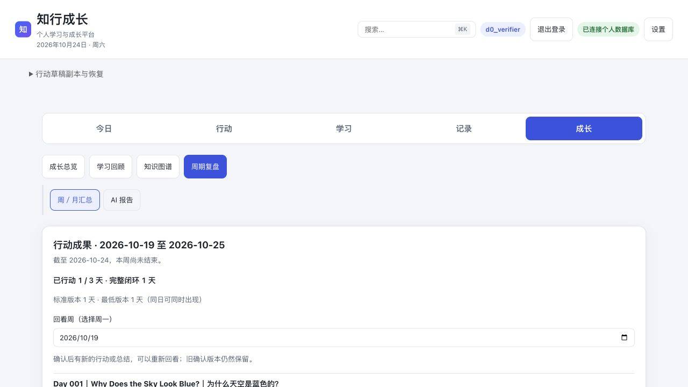

# D0 本地启动与日常节奏核查

日期：2026-10-24。结论：**已完成本机状态核查和隔离安装的关键流程验证；原账号环境因缺少必要配置尚不能启动，暂不进入真实14天窗口。**

本轮修复了一项可复现的节奏设置初始化竞态。此前整页加载超时未在两轮带请求记录的复验中复现，两者不能直接认定为同一问题。

## 1. 本机原环境

| 检查 | 实际结果 | 影响 |
|---|---|---|
| 本地服务 | `127.0.0.1:8756` 无监听；旧`.server.pid`指向的进程不存在 | 没有可核对的原本地运行版本，PID文件不能作运行证据 |
| 本地代码 | 基线`3f0b83edbfafedd0bc68232c3c0e4ea8948cafd9`；修复提交`8b52654b1b4778a4e4d638429d0585a8d61d79c7` | 修复已提交本地分支，未推送；前轮及本轮文档仍留在工作区 |
| 跟踪信息 | 本机`origin/main`比基线多3个提交，包含搜索修复及学习资料；本轮未fetch/pull | 不自动将其他改动并入当前验收基线 |
| 工作分支 | `codex/d0-rhythm-startup` | 从当前代码创建，保留既有文档及未跟踪文件；没有重置或覆盖 |
| Python环境 | 根目录`.venv`不存在；隔离验证使用已有`/tmp/grow-web-batch1-env` | 真实长期使用还需按部署手册建立自己的持久运行环境 |
| 配置预检 | 缺少`APP_PASSWORD`、`ACCOUNT_ENCRYPTION_KEY`、`LEARN_ROOT` | `deployment.py`按预期拒绝启动 |
| 数据目标 | 已有`DATABASE_URL`指向远程PG，GitHub配置存在 | 本轮未连接该业务库、未迁移或初始化其中数据 |

用户选择沿用原数据后的准备：确认`知行成长/.venv`为Python3.13.9，按根`requirements.txt → requirements.lock`对齐运行依赖，全部版本匹配且`pip check`通过。可使用这一项目虚拟环境，无需为启动另外创建根`.venv`。随后执行正式预检，仍只因`APP_PASSWORD`、`ACCOUNT_ENCRYPTION_KEY`和`LEARN_ROOT`未提供而退出，尚未连接远程业务库。

预检在必要字段检查阶段即返回错误，没有将远程库替换成本轮临时库，也没有生成新密钥覆盖原配置。继续沿用原账号时，应恢复其原管理账号配置和原加密密钥；`APP_PASSWORD`取值变化会触发管理账号口令更新，不能把测试值填入原环境。

## 2. 隔离运行实例及版本证明

为继续完成独立检查，本轮新建了专用localhost PG和临时运行目录，复制当前生产源码，按正式`deployment.py check/serve`入口启动应用于`127.0.0.1:8757`。复制时排除`.env`、运行数据、旧归档与测试目录，只通过`prepare_materials.py`导出发行教材。

- 测试账号为`d0_verifier`，全部行动、总结、周卡和入组均为合成验证内容，与原账号隔离。
- 启动时核对实际进程PID、工作目录、启动时间、完整代码SHA和`/api/health`。健康接口的revision来自本轮启动参数；另外比对HTML和4个关键JS的HTTP正文SHA-256，避免只相信一个版本标签。
- 修复后验证时实际运行内容为**基线3f0b83e + 当时未提交的D0静态文件修复**；随后将同一份修复提交为`8b52654`，按[受测文件哈希](evidence/tested-source.json)核对内容一致。健康接口的基础SHA不能单独代表当时的工作区文件，具体差异及HTTP资源哈希见[运行来源核对](evidence/served-source-verification.json)。
- 未配置真实GitHub或模型，计划/认知内容模块的不可用状态按实际保留，内置英文与表达教材可读取；这不构成真实内容仓库验收。
- 本轮停止并重启了隔离应用与PG，再验证账号、设置与数据持久性。临时服务不是14天使用实例，验收后关闭；未为个人账号启用或入组。

运行来源、哈希、进程与清理情况见[元数据](evidence/runtime-metadata.json)。凭证不进入证据包。

## 3. 实际界面走通结果

使用浏览器操作正式应用页面与真实HTTP/PG路径，未通过浏览器注入替代业务保存。

| 场景 | 结果与语义核对 |
|---|---|
| 实际登录 | 测试账号登录成功，首页显示账号及“已连接个人数据库” |
| 默认设置 | 首次功能关闭、每周3天、Asia/Shanghai、提醒关闭；手动保存后生效 |
| 今日一件事 | 新建测试待办并在实际尝试前选为主任务，创建与选择结果可见 |
| 今天轻一点 | 确认做过最小步骤后生成零分钟partial；完整待办仍未勾完 |
| 总结与下一步 | 保存一句总结和下一步；刷新后原文恢复；保存总结未制造第二次行动 |
| 周成果与调整 | 选择一条成果、一项调整及其行动引用；确认版本1可回看，新事实到来时提示重新核对 |
| 内置课程与笔记 | 英文首课可安排、打开和独立暂存笔记；暂存不标为学完 |
| 计时行动 | 内置英文当前按能力退回计时模式；确认合成投入后保存执行，与课程学完独立。1分钟为模拟测试输入，不是个人真实学习时长 |
| 两周入组 | 仅在临时账号点击入组，显示D1至D14区间；入组前两次测试行动未进入试验分子，D7/D14问卷未到期 |
| 私人导出 | 实际下载`grow-rhythm.json`，格式与内容可读，无running悬挂 |
| 进程/PG重启 | 重新加载仍已登录；设置、主任务、2个行动、2条执行、周卡和入组前后逐值一致 |
| 浏览器异常 | 本轮实际浏览器未记录到warn/error；缺少GitHub配置的模块503按环境限制记录 |

重启前后数据核对见[一致性结果](evidence/restart-verification.json)。[合成导出](evidence/synthetic-rhythm-export-after-restart.json)只包含本轮临时数据，不作为个人14天样本。

## 4. 可复现的设置竞态与修复

**触发**：开启节奏后在设置页刷新，或应用重启后恢复`#view/settings`。页面登录和节奏数据读取均成功，设置区仍可能一直显示“正在读取节奏设置…”。再次点击设置可恢复，但直接刷新不可靠。

**根因**：首次`refresh()`之后单独调用一次`settings()`；同时`plans:loaded`等事件会启动更新的读取。首次读取被较新请求取代时提前返回，随后的那次`settings()`还拿不到state。较新请求完成后只渲染今日卡，没有再初始化设置表单。

**修复**：由实际成功的最新读取负责首次初始化设置；后续后台刷新保留正在编辑的表单。连接能力不支持时重置初始化状态，恢复后重新建立表单。同时更新JS资源版本，避免旧缓存保留该问题。

| 文件 | 变化 |
|---|---|
| [daily-rhythm.js](../../../知行成长/server/static/daily-rhythm.js) | 最新成功读取初始化设置，保护尚未保存的输入，取消只挂在首请求后的初始化 |
| [index.html](../../../知行成长/server/static/index.html) | 节奏JS版本更新为`20261024-d0-settings` |
| [确定性请求竞态测试](../../../知行成长/server/tests/test_daily_rhythm_settings.cjs) | 人为控制旧/新读取完成顺序；修复前失败，修复后通过；同时检查未保存时区不被后台刷新覆盖 |
| [浏览器测试](../../../知行成长/server/tests/test_rhythm_browser.py) | 新增设置页刷新恢复及未保存输入保护 |

失败先于修复留档：[修复前日志](evidence/settings-race-before-fix.log)。修复后又通过实际浏览器冷刷新验证，并重新看到原入组记录与不可提前填写的问卷。

## 5. 此前页面加载超时的排查

此前失败发生于`page.goto/reload`等待整页`load`超过原10秒限时；原始证据保留在[前轮核查](../current-state-2026-10-24/README.md)。本轮保持相同测试断言和10秒限时，记录请求开始/结束、导航阶段、页面异常，以及若超时发生时的待完成请求与夹具错误管道状态。

| 轮次 | 用例 | 导航次数 | 最长导航 | 页面脚本异常 |
|---|---|---|---|---|
| 修复前诊断1 | 行动P0浏览器8项通过 | 18 | 986.9ms | 0 |
| 修复前诊断2 | 行动P0浏览器8项通过 | 18 | 489.6ms | 0 |

本轮没有出现需要放宽超时的证据，也未观察到夹具错误管道堵塞。不能断言此前只是机器负载，亦不能将已修复的设置渲染竞态当成整页load超时的已确认根因。保留导航诊断脚本、逐请求记录与结果，后续复发时按同样方式收集；不靠循环重试或延长等待掩盖失败。

修复后通过同一次关联回归：**29份Python文件、185项用例，28份JavaScript文件，0失败、0跳过**。其中节奏87项（含新增浏览器用例）通过，行动P0浏览器8项通过，新增确定性设置竞态测试也通过。该集合包含节奏、行动/来源完成、课程笔记与状态、请求并发限制和正式部署入口重启检查；`full_profile=false`，不冒充完整仓库或真实外部服务验收。[逐项结果](evidence/after-fix/results.json)

诊断轮次与修复后的用例有重复，不加总为独立样本。隔离审计的三个`blocked_*`全部为0；完整网络跟踪见[诊断1](evidence/navigation-round-1/navigation.jsonl)和[诊断2](evidence/navigation-round-2/navigation.jsonl)。测试和实际隔离浏览器均未使用真实业务库或付费模型。

## 6. 原账号环境放行与入组步骤

当前个人环境的放行项尚未全部完成：

- [x] 核对本地服务与仓库基线，明确原服务未运行。
- [x] 隔离运行正式应用，验证核心节奏、保存、重启与导出。
- [x] 复现并修复设置初始化竞态，保留先失败后通过证据。
- [x] 带导航诊断复验此前超时，明确“未复现、根因未定”。
- [x] 参与者明确选择沿用原账号和数据，并将在本机补齐原登录密码及原加密密钥；不创建独立数据安装、不迁移历史数据。
- [ ] 在本机安全补齐实际账号与加密配置，准备发行教材和持久Python环境。
- [ ] 对实际目标实例运行预检、启动及登录核对，确认课程/记录等需要的模块就绪；再次核对运行资源版本。
- [ ] 由本人在实际目标实例开启节奏、入组，记录真实D1/D7/D14。

若沿用原数据，在已有`知行成长/server/.env`中安全恢复**原管理账号、原登录密码、原ACCOUNT_ENCRYPTION_KEY**；不要把值发进聊天或提交Git。保留原数据库与内容仓库绑定。`LEARN_ROOT`使用发行教材导出目录，避免将旧个人进度作为新账号教材。具体安装仍按[部署手册](../../deployment/standalone-web.md)，不要使用本轮临时账号或测试数据库开展14天观察。

实际实例通过后，按下面顺序开始：

1. 登录本人账号 → 设置 → 日常节奏，确认Asia/Shanghai与每周3天，提醒先关闭，勾选开启后保存。
2. 点击“两周试用与问卷”，阅读说明，由本人点击“加入两周试用”。**保存设置不等于已经入组。**
3. 以页面显示区间填写[14天计划](../../../知行成长/docs/daily-rhythm-14-day-validation.md)中的日期。入组当天剩余时间即为D1；可以选择准备好的一天开始。
4. 入组之后，再选择一项真实行动作为今日一件事。D7选一项调整，D14当天反馈，D15再导出最终数据。

原账号环境尚未放行前，保留以上条件与步骤，不代填事实或启动正式观察。

## 7. 2026-10-25 原数据库只读复核

用户再次确认已保存配置后，重新从明确的`server/.env`读取并运行正式预检。执行端仍看到文件为352字节、修改时间2026-10-20 23:31:38+08:00，路径解析一致且不是符号链接；`APP_PASSWORD`、`ACCOUNT_ENCRYPTION_KEY`、`LEARN_ROOT`三个变量仍不存在。8756无服务监听，本轮没有启动应用或改变口令/加密配置。

独立的原数据库核查已完成：显式执行只读事务并确认`transaction_read_only=on`，只查询账号存在性与记录数量，随后回滚/关闭。原管理账号存在，共2个账号；原管理账号空间含日常记录1、学习计划1、课程1、课程反馈1、行动3、执行事实2、阅读记录133、课程学习记录6、知识节点71。[只读结果](evidence/original-account-check-2026-10-25.json)

这些数量属于2026-10-25快照，不等于全部是真实使用样本，也不是相对旧快照的增长效果证据。它们确认现有库并非新建空库；本轮没有改写记录。当前剩余阻塞是用户编辑端与执行端配置文件内容不一致，需以不输出密钥的变量存在性检查对照，不能绕过预检或生成新密钥替代原密钥。
