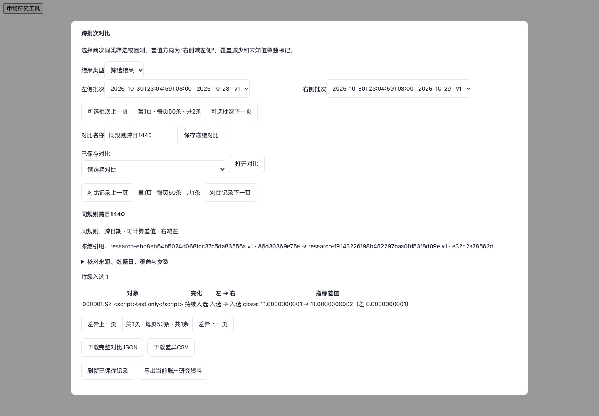
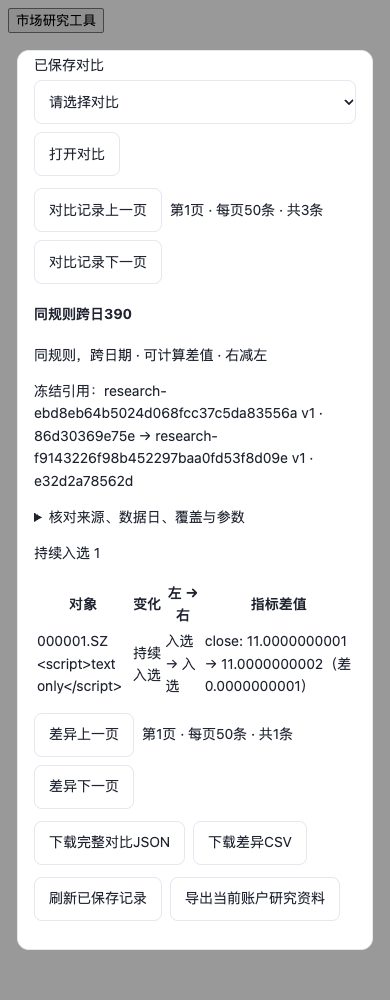

# 研究归档与对比验证（2026-10-30）

[操作与范围说明](../../investment-research-archive-delivery-20261030.md)。运行中HTTP功能版本`4bd1326`；后续修复只涉及离线恢复和测试环境，不改变已加载的HTTP代码。

**最新完整回归已通过**：在提交`cfd9d49`上重新从头运行`--full`，1082项Python测试与39份JavaScript检查全部通过，零失败／错误／跳过，退出码0。上轮三个浏览器失败用例均在本轮完整执行中通过。见[完整日志](full-regression-final.log)及[结果摘要](full-regression-final.json)。以下首轮失败和定向修复记录保留为历史。

- [最终定向日志](focused-final.log)：19项，0跳过／失败／错误；隔离审计中真实工作区写入、外网和真实数据库访问均为0。
- [真实本机服务](local-service.json)：登录成功，10模块ready，归档目录700且独立于源码；桌面1440、手机390无溢出／脚本错误／HTTP5xx。用户当前0个投资账户，未添加合成账户。
- [备份恢复](backup-restore.log)：含5份归档及依赖、冻结对比恢复至新目录和空库；重放结果与资金不变；缺根目录、漏归档元信息和祖先链接拒绝。
- [文件反例](archive-files.log)、[服务反例](archive-service.log)、[对比](comparison.log)、[真实浏览器](browser.log)、[测试隔离](isolation-dirfd.log)。
- [首轮全站日志](full-regression-initial.log)：1080项Python，1077成功／2失败／1错误，0跳过；39份JS均成功。测试后增补的2个反例包含在最终19项中。
- [连接重置复现](browser-fixture-reset-reproduction.log)：旧浏览器测试服务并发静态资源出现`ERR_CONNECTION_RESET`，造成依赖全局对象未定义。隔离测试环境的标准库ThreadingHTTPServer backlog改128，未改变生产服务及功能断言；[三个失败用例定向重跑](browser-fixture-repair.log)全部通过且未再记录连接重置。未声称修复后再次跑完完整全站测试。
- [机器可读汇总](summary.json)。

定向检查复现：先按[部署手册](../../deployment/standalone-web.md)启动独立localhost临时PostgreSQL，使用非默认端口；安装既有测试依赖和Chrome，然后运行：

```sh
TEST_POSTGRES_DSN='host=127.0.0.1 port=YOUR_TEST_PORT user=YOUR_TEST_ROLE dbname=postgres' \
.venv/bin/python -B docs/verification/research-archive-20261030/run-focused.py
```

全量命令使用`知行成长/server/tests/run_isolated_checks.py --full`，另设置`TEST_ZOOK_WORKTREE`为真实合同fixture仓库、`TEST_NODE`、`NODE_PATH`及`CHROME_EXECUTABLE`。本次使用已安装Python依赖、系统Chrome和随运行环境提供的Node Playwright，未更换业务依赖或调用外部供应商／模型。

截图为隔离合成数据，证券名称中的脚本文本用于检验转义，无可执行脚本。



