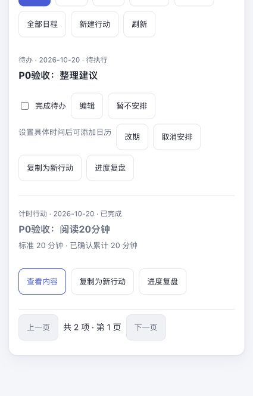
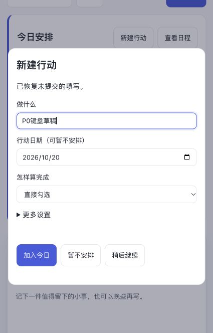
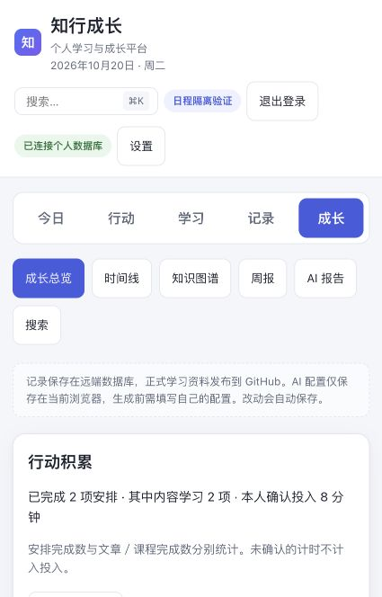
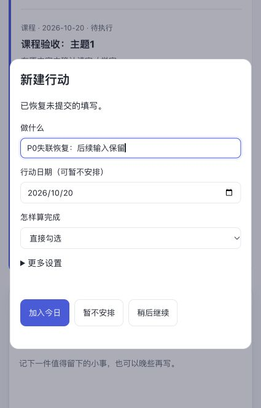

# P0 实施与验证记录

日期：2026-10-20，Asia/Shanghai。

**结论：Grow 本地 P0 功能已实现，主要服务端与浏览器路径通过；完整验收尚未全绿。** 任务为24/26完成，7.1与7.3保留未完成。未扩展P1/P2，也未部署、迁移真实数据或配对真实账号。

## 工作区与基线

- 工作分支：`codex/action-plans-p0`。
- 工作目录：`/Users/hao/.codex/worktrees/action-plans-p0/grow`，已附到本聊天。
- 原仓库分析基线：`0c59d77764921e6090ead60de4402bce2cc68c05`。
- 该基线上的19份既有日程改动和已确认P0规格先在独立目录保存为 `d7bf19d`，作为实施前快照；这些前置日程改动不能算作本轮从零新增。
- 原工作区中的并行改动未被覆盖，本轮实现仅在上述工作区进行。
- 测试使用localhost PostgreSQL独立临时schema、合成账号、HTTP级GitHub替身和确定性模型替身。未访问真实私人记录或调用真实收费模型。

## 已实现的行为

- time/content/check条件字段；日行动日期与具体时间可空，未安排不伪造今日/21:00。
- 行动四状态与唯一running会话分离；版本冲突、父级阻断、执行后配置锁定和终态限制。
- 同一计时行动累计本人确认分钟，起步/部分/中断分开；中断达标后可显式确认，不要求虚构新分钟。
- 勾选完成写零分钟事实，撤销追加reversal，再勾选仍只贡献一项有效完成。
- 文章、课程计划课程的明确确认通过私人发布日志原子写回执；同步失败、计时未结束时可稍后核对，不用旧read=true补造事实。
- 所有内容安排入口共享归一化身份去重、null日期桶、改期冲突、取消和提醒资格规则。
- 新事实记录原计划日期与实际发生日期；记录、成长和新复盘预览统一统计，历史快照保留。
- 快速表单、来源带入、日程/未安排/待调整视角、按模式操作、重复提交恢复、草稿隔离与未知请求后新输入分叉。
- P0写版本头与能力检查；不支持的连接端禁止P0写入；旧本地回执仍可只读核对。有P0数据时禁止使用不完整旧接管包新配对。

## 自动化回归结果

可重复命令（在本工作目录）：

```sh
TEST_LEGACY_PG_DSN='host=127.0.0.1 dbname=postgres user=hao' \
PYTHONPATH=知行成长/server:知行成长/server/tests \
/Users/hao/Documents/grow/知行成长/.venv/bin/python -u 知行成长/server/tests/run_action_p0_regression.py

node 知行成长/server/tests/test_action_plan_client.cjs
node 知行成长/server/tests/test_action_p0_client.cjs
```

Python共运行 **84项：82通过、1报错、1跳过**。两个Node客户端检查组通过。`git diff --check`和变更JavaScript语法检查通过。结果与逐套件日志在 [regression-results.json](evidence/regression-results.json) 及同目录中。

| 套件 | 运行数 | 结果 |
| --- | ---: | --- |
| test_action_p0 | 15 | 通过 |
| test_action_p0_sources | 3 | 通过，含来源SQL和确认回执共同回滚 |
| test_action_plans | 7 | 通过 |
| test_action_reviews | 13 | 通过 |
| test_daily_arrangements | 6 | 通过 |
| test_arrangement_sources | 5 | 通过 |
| test_github_plans | 15 | 通过 |
| test_study_notes | 11 | 通过 |
| test_study_materials | 5 | 4通过、1跳过 |
| test_legacy_cloud_api | 2 | 1通过、1报错 |
| test_plan_read_errors | 2 | 通过 |

未通过项为 `LegacyCloudAPITests.test_course_generation_publication_learning_and_reading_ai`：认知课程读取使用`copilot_learning_records.archived`，该独立初始化路径缺少此列。已从 `d7bf19d` 提取未实施P0的代码，在新的独立schema重跑同一套件，复现同样错误；证据为 [baseline-legacy-cloud-api.log](evidence/baseline-legacy-cloud-api.log)。本轮未改该认知课程初始化路径，不把它记作P0新增回归，也不把它隐去或算通过。

跳过项为 `test_browser_save_retry_next_course_notes_calendar_and_mobile`，其既有条件要求`RUN_GITHUB_BROWSER=1`与真实Chrome；本轮使用IAB手动验收，不将两者混为同一个已执行测试。

## 本轮实际浏览器路径

浏览器：Codex应用内浏览器；临时服务：`serve_daily_arrangements_fixture.py`。试验端口随启动改变，夹具不对应生产站点。

| 路径 | 实际观察 |
| --- | --- |
| 快速创建check并暂不安排 | 保存成功，今日列表不显示，未安排视角可见 |
| 未安排→安排今日并完成→撤销 | 状态按预期变化；事项保留，可再次操作 |
| time：先做5分钟，再确认15分钟 | 同一行动显示累计20分钟并完成；未生成两项完成 |
| 文章加入明日→明日预览→改到今日→明确读完 | 今日安排完成，成长显示1项内容完成、0分钟 |
| 课程加入明日→改到今日→打开课程→本人确认学完 | 修正夹具租户字段后重跑通过；学习笔记单独保存，课程安排完成 |
| content计时中明确读完→确认投入8分钟→核对完成 | 原会话未被静默结束，最终课程+文章共2项内容完成、确认投入8分钟 |
| 键盘输入→Escape关闭→重新打开 | 草稿恢复；焦点返回原新建行动按钮 |
| 提交已落库但返回503模拟丢响应→修改输入→再次提交 | 未再次创建，显示先核对原请求；新输入另存草稿 |
| 核对原提交→再次打开快速创建 | 原行动唯一保存；新输入草稿仍保留，无需换新key猜测重建 |
| 320/768/1024/1440宽度 | 快速表单无横向溢出；检查后恢复原视口 |

丢响应通过测试夹具在真实创建提交后替换为503实现，**不是实际切断TCP或设备网络**。四个断点的尺寸数据在 [responsive-checks.json](evidence/responsive-checks.json)。

证据截图：









## 50个验收用例的证据范围

下表是对 [acceptance.md](acceptance.md) 的证据映射。“部分”表示复合用例中有子条件或指定层级未实际执行，不等于功能已证明失败，亦不算整例通过。

| 用例 | 证据与限制 |
| --- | --- |
| F01、F02 | API与浏览器通过 |
| F03、F04 | API参数边界通过；未逐个在浏览器触发全部错误提示 |
| F05 | 缺失/不支持来源API校验通过；全部跨账号来源类型未逐一浏览器验证 |
| F06 | check/time切换浏览器通过；所有来源更换组合未逐一验证 |
| F07 | API提醒依赖通过；浏览器系统通知权限未验证 |
| F08 | 部分：已覆盖POST响应丢失恢复；“POST成功且仅后续GET刷新失败”的浏览器故障未单独注入 |
| F09 | 有效上级、暂停上级、日期边界回归通过；全部时区/越界组合未穷举 |
| F10 | 首字段焦点、Escape返回、键盘草稿与隐藏字段通过；完整屏幕阅读器未验证 |
| T01、T03、T04、T05 | API通过；浏览器通过T01与运行/确认路径，未逐一手动覆盖全部T03/T04/T05分支 |
| T02、T06、T07、T08 | 状态、部分投入和非法模式核心API通过；复合用例全部分支未逐一UI执行 |
| C01、C02、C05、C06、C07 | API通过；浏览器覆盖文章/课程确认、内容计时与核对；C06服务端同步故障和次日核对通过API验证 |
| C03 | API通过旧read标志不足、反馈不完成；未逐一对两模块滚动/所有笔记入口做浏览器故障验证 |
| C04 | 今日/未来/过去/未安排隔离API通过；不同账号来源未逐一浏览器执行 |
| C08 | 同key回执与异payload冲突通过；全部伪造事件/跨账号事件组合未逐项执行 |
| C09 | 部分：代码保留历史并锁定已完成；来源取消后再学习的完整浏览器路径未单独跑 |
| C10 | 来源保存失败及SQL事务内失败均验证无回执/无虚假完成，课程事务回滚通过 |
| K01 | API与浏览器通过 |
| K02、K03 | 并发/幂等、撤销限制API回归通过，未全部浏览器重复执行 |
| S01 | API并发去重与浏览器已有安排通过 |
| S02 | 同日期/null桶、同名独立事项通过；全部异时区去重组合未穷举 |
| S03、S04、S05 | API改期冲突、撤销日期、取消保留通过；浏览器完成改期与未安排路径，取消所有来源组合未逐项执行 |
| S06 | API不自动顺延通过；过去running/暂停及全部时区的浏览器组合未逐项执行 |
| S07 | 未安排/未来API拒绝及浏览器安排后完成通过；第二步冲突UI文案未单独故障注入 |
| S08 | API提醒资格/日历/免打扰回归通过；设备日历导入和真实通知未验证 |
| A01、A02、A03、A04 | 补做、跨午夜、去重聚合、旧记录日期口径与复盘API通过；历史混合日期的全部UI/导出组合未逐项执行 |
| A05 | API终态/事实配置锁定与复制入口实现；所有复制去重组合未逐项UI验证 |
| R01、R02 | 客户端上下文/账号隔离通过；同上下文多草稿和真实切换登录账号浏览器组合未逐项执行 |
| R03、R04 | 客户端同key恢复、不可变pending、分叉保留base revision通过；浏览器503模拟丢响应、阻止新提交与核对后新草稿保留通过；真实多标签编辑冲突未手动执行 |
| R05 | 原有租户隔离、外账号行动、同源保护回归通过；全部来源/回执外账号组合未逐一端到端执行 |
| R06 | 旧连接端模拟能力拦截、配对不冻结、旧回执只读通过；真实Zook与原生双端未验证 |

## 合同边界与未验证部分

检查的Zook目录为`/Users/hao/Documents/project/Zook`，HEAD=`47d19fb5554abc002de4e6e9795a2fa294387239`。当前检查的唯一OpenAPI合同未提供本P0声明的`action_schema_version:2`、nullable日程、来源回执和新事实语义。本轮只读取比较，没有改Zook或原生端，也没有建立第二份公共合同。

- 7.3保持未完成：真实Zook/iOS/Android双端合同、接管和原生通知未验收。
- Grow连接请求必须检查远端版本；不支持时拒绝P0写入，不回退到本地双写。
- 本地已有P0数据时，新配对预览被拒绝，避免旧包遗漏来源事件后冻结或迁移不完整。
- content支持文章和课程计划课程。英文/表达/认知等其他模块未具备本回执保证时，从来源安排进入time方式；不宣称它们已支持content。
- 真实系统通知权限、设备日历导入、实际断网、屏幕阅读器、真实生产迁移与部署未验证。

## 使用说明与交付门槛

1. “新建行动”默认勾选事项；选择投入时长才填写标准分钟，选择内容完成需明确文章/课程。日期可留空保存未安排。
2. 当天做可以不设几点；打开提醒必须另设日期与具体时间。网页关闭提醒仍依赖独立设备日历副本。
3. 内容完成与投入分别确认；计时中读完先保存实际投入，再核对已保存的确认回执。
4. 未知提交结果先核对/重试原请求；改变的输入另存草稿，不通过新key重复创建。
5. 当前可评审本地实现；**不能据此宣称全部P0验收通过或允许未验证连接端写入**。下一实施门槛是解决基线认知课程回归，并补齐上表部分验证项及7.3。
