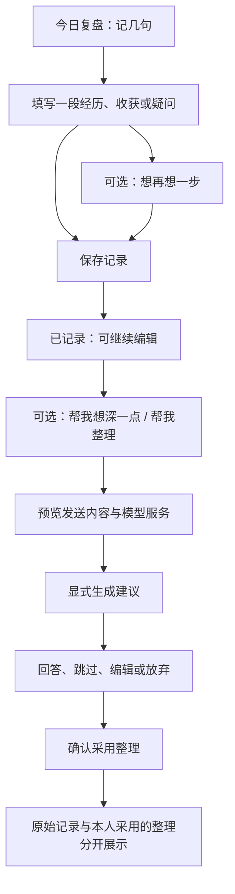

# 日常复盘设计：先记下来，再按需深入

状态：设计待实施。日期：2026-10-14。设计对象为知行成长的“今日复盘”和“记录 → 每日复盘”，沿用现有页面风格、配色和导航；不重做整个平台。

## Context

用户提供的截图显示“新增复盘”对话框：日期与四个等大的输入框。结合现有代码可确认：

| 当前实现 | 对此次设计的影响 |
|---|---|
| `static/index.html` 中 `REVIEW_FIELDS` 固定为 thought、actual、gap、action；`openReviewForm` 复用通用表单 | 自由记录需要专用编辑界面，不能只改四个字段标题 |
| `renderPersonal` 为每条记录显示四段内容，空值补“待补充” | 新入口之外，今日卡片也必须改，否则保存后仍显得没有填完 |
| `renderReviews` 按原来怎么想、下次行动做表格摘要 | 记录列表应展示正文摘要和日期，不把没有行动的记录显示为空 |
| `openReviewForm` 修改内存、调用延迟保存后立即提示成功 | 新保存需要等待服务端结果，失败时保留正文与编辑界面 |
| `/api/data` 全量删除并重建 `reviews`，其整数id不能作为新功能的长期身份 | 新记录采用独立表、稳定编号及专用接口，不依赖旧数组下标 |
| `sync_reviews.py` 只扫描 `执行复盘/` 直属的日期文件，启动时导入 `pending_sync.json` | 新目录须避开该扫描范围，防止重复导入与额外打卡 |
| 已有模型设置、流式传输、生成任务状态及共享生成锁 | 可复用连接能力；复盘内容须另设上下文合同，不能套课程生成提示 |

本设计依据截图、用户反馈和代码检查；未进行用户访谈，不声称已证明记录率会提高。没有读取个人复盘内容作为设计样本。下文例子全部为虚构场景。

## Goals / Non-Goals

**Goals:** 一段真实记录即可保存；按需提供具体思考线索；AI建议与本人原话明确分开；保存、编辑、版本、离线文件和旧数据衔接完整。

**Non-Goals:** 不要求每日打卡，不给复盘质量打分，不推断掌握程度或心理状态，不自动扫描历史，不自动生成待办或调整学习计划，不建设通用聊天窗口。本次产物是方案和清单，不是已上线页面或视觉定稿。

## Decisions

### 1. 信息层级与主流程

**默认：记下来；可选：想一步；按需：请AI协助。** 三层能力共用一条记录，不让用户先做类型选择题。



没有选择深入或AI也算一条完整记录。记录数量不转换为课程完成数；写“下一步”不代表已经行动。

### 2. 默认编辑界面

标题使用“记下今天的一点收获”；从其他日期进入时显示“记下10月13日的一点收获”，日期继承当前查看日，可修改。按钮从“添加今日复盘”改为“记几句”；“记录 → 每日复盘”的新增入口使用同一编辑器。

结构示意（不是最终尺寸稿）：

```text
记下今天的一点收获                         关闭
10月14日 · 可修改日期

今天有什么值得记下来？
┌────────────────────────────────────────┐
│ 一件做成的事、一个卡点、一次意外，       │
│ 或学习后冒出的疑问。写几句就好。         │
│                                        │
└────────────────────────────────────────┘
找个切入点： 学习收获   遇到困难   决策回顾
▸ 想再想一步（可选）

                                  保存记录
```

- 日期默认有效，正文非空即可保存；不强制标题、分类、结论或行动。正文上限暂定10,000字，超限就地提示并保留内容。
- 可选提示以轻量按钮展示，未选择时属于“自由记录”。点击仅改变辅助提问，不替换、清空或往正文插入模板。切换后已写的深入回答保留在“已补充内容”中。
- 主操作只有“保存记录”，不把AI按钮摆成必经步骤。首次保存后才显示AI操作；没有配置时仍可完整记录。
- 建议在现有弹窗基础上提供约640px阅读宽度、内部可滚动正文及可见的底部操作区；窄屏自适应，无横向滚动。标签不依赖placeholder，关闭后焦点回到触发按钮，键盘可操作全部控件。
- 正在保存时防止重复提交；失败就地提示，保持弹窗和全部输入。关闭、切换页面或刷新有未保存内容时提示，不静默丢弃。不新增浏览器持久化副本；跨刷新草稿恢复不在第一阶段。

### 3. 可选提示与深入问题

以下提示由本地静态文案提供，不调用模型；每次只展示当前方向的一组，最多三问，均可不答。正文中的同类信息无需重复填写。

| 方向 | 正文下的引导 | 展开后的可选问题 |
|---|---|---|
| 自由记录 | 今天有什么让你想多停一下？ | 最值得保留的发现是什么？还有哪里没想明白？ |
| 学习收获 | 今天哪个内容让你有了新理解，或仍有疑问？ | 能用自己的话说一遍吗？准备在什么情境试用？ |
| 遇到困难 | 当时具体卡在哪一步？ | 已经尝试过什么？下次愿意先试哪个小变化？ |
| 决策回顾 | 今天做了什么选择？ | 当时依据是什么？后来观察到什么？还有哪些原因不能确定？ |

额外提供折叠入口“用四问深入复盘”，使用“当时的预期／实际观察／可能原因与待核实处／下次想试的调整”，第三问允许“还不确定”，不再要求在运气和能力之间二选一。它是分析工具，不是每次记录的完成标准；已有历史四问记录仍保留原标签与原值。

### 4. 保存后的阅读与首页卡片

今日区域按记录时间展示：正文前约120字、可选方向、内容状态、查看/编辑。空的深入字段不渲染；没有记录时文案为“记下一件值得留下的小事，也可以晚些再写。”，不展示未完成红色告警。

| 状态 | 出现条件 | 用户能做什么 |
|---|---|---|
| 已记录 | 正文与本地文件保存成功 | 查看、编辑、补充、选择AI |
| AI建议待确认 | 完整有效建议已返回，尚未采用 | 打开草稿、编辑、采用或放弃 |
| 已整理 | 用户确认采用整理结果 | 查看原话与整理、再次编辑 |
| 整理依据已更新 | 原文在采用整理后发生修改 | 查看旧整理及其版本，手动重新整理 |

原话始终可读。AI输出不作为默认卡片摘要，除非用户确认采用；卡片摘要只来自当前本人正文或依据未过期的已采用整理。记录列表按日期聚合但保留每条身份，同日可有多条，不合并覆盖。

### 5. AI辅助：两个明确动作

**帮我想深一点**：读取本次选定文本，提出0–2个针对具体内容的问题。上下文不足时询问缺失事实；信息已足够时可以不追问。用户可逐题回答、跳过或结束；不设置进度条、不强迫答完，也不自动循环追问。

**帮我整理**：把已选原话与回答整理为“发生的事情／我目前的认识／下一步想试什么”，仅保留有依据的部分。三段是阅读框架，不是必填表；无行动就省略，无结论可写“尚不确定”。不把模型推测写成本人已经确认的原因。

虚构示例：

> 原话：“今天学了确认偏误，但开会时还是只找支持自己方案的例子。”
>
> 追问：“你能想到会上哪条不同意见没有被继续讨论吗？”
>
> 回答：“同事说样本太小，我没有追问。”
>
> 整理草稿：“会议中没有继续核对样本量问题。当前还不能确定它是否足以改变方案。”
>
> 单独标注的建议：“下次评审先问一次：什么证据会让我改变判断？”

最后一句属于AI建议，只有用户选择保留才进入正式整理；不能变成“我下次一定会……”。不把示例表现判断为用户具有某种人格或心理疾病。

#### 发送边界

- 用户点击AI动作后先展示可编辑的“本次发送内容”：默认当前已保存正文，回答逐项可取消；不包含未选回答、历史日记、情绪记录、课程全文、其他数据库记录或待办。
- 明示当前配置的模型与服务域名、“以下内容将发送至该服务，可能产生费用”。用户可删去人名等细节、返回本地编辑；最终按钮为“发送并生成”。配置或文本变化后以最新预览为准。
- “保存”只写本地；“打开记录”“刷新结果”“查看历史”均不调用模型。权限不由一次允许安装依赖替代。
- 仅发送预览后的快照；密钥只在服务端请求认证中使用。输入与模型输出都是数据，不能执行指令、读取额外文件或改变路径。
- 输出无外部知识检索；涉及原因的推测必须标记为待核实建议。第一期不生成引用、诊断、投资建议或成长评分。

#### 草稿与请求合同

复用配置解码、httpx传输与 `.ai-generation.lock`；单独实现复盘任务提示和结构验证。每次显式调用生成唯一请求键，记录任务类型、模型、输入版本与哈希、预览快照、用量、计价版本和状态。不得把私人正文写入控制台日志。

建议结构：追问返回 `questions[{id,text,anchor}]`（0–2条，anchor须为所选输入的原文片段）；整理返回 `sections[{kind,text,basis}]`，kind为event/understanding/next_step，basis区分“原文整理”和“建议”。缺少依据的结论拒绝伪装为事实；这些校验只能降低风险，不能证明语义真实，仍须本人审阅。

`queued → generating → ready / failed / cancelled` 与记录保存状态分离。总超时180秒，有限输出，允许取消；中断保留片段供查看，但不允许采用。刷新只读取已存在请求，失败重试需要再次点击和发送预览，不自动收费重试。模型忙时不影响本地保存。

AI完成后，用户可修改或放弃；只有“保存这份整理”才写入正式记录。采用校验原文版本、选定回答及请求快照，已变化则要求重新核对，不能覆盖新原文。回答有独立本地保存操作，不因模型失败丢失。

### 6. 数据、版本与本地目录

新增记录使用服务端UUID身份 `ref-<uuid>`，同日多条独立保存。建议独立表：

| 表 | 保存内容 |
|---|---|
| `reflection_entries` | id、record_date、created_at、updated_at、version、prompt_kind、raw_text、guided_answers、adopted_summary、summary_basis_version、archived_at、镜像哈希与固定路径 |
| `reflection_versions` | 每次保存的正文、回答、已采用整理及来源版本，保留编辑前状态 |
| `reflection_ai_attempts` | 任务状态、明确发送的快照、输出草稿、问题回答、采用状态、用量与费用；不存密钥 |
| `reflection_operations` | 幂等键、发布意图、文件内容快照、旧哈希与恢复状态 |

记录、回答和整理在同一条逻辑记录下管理，任何更新都带base_version。整理额外保存所依据的正文与选定回答哈希；判断整理过期时比较这些输入，而不是把“采用整理”导致的记录版本递增本身当成过期。SQLite保存权威状态；Markdown为离线可读镜像。原文版本永不因采用AI而替换为摘要。

新路径方案（实施后生效）：

```text
执行复盘/
  YYYY-MM-DD.md                  # 既有手工/外部生成记录，保持原样
  复盘记录.md                    # 既有索引，保持原样
  日常记录/
    README.md                    # 新记录使用说明，不维护易冲突的全量索引
    YYYY-MM/                     # 创建日期的月份，后续修改记录日期不搬迁
      ref-<uuid>.md              # 固定文件名，不从用户正文或AI生成路径
```

文件含稳定编号、记录日期、方向、版本、原始记录、本人补充、本人采用的整理及其来源说明。AI未采用草稿仅存在数据库，不混进正式Markdown；页面提供单条历史版本查看，完整历史由完整备份保存。正文中空段落省略。

专用接口建议：`/api/reflections` 列表/创建；`/{id}` 读取/按版本更新；`/{id}/versions` 查看历史；`/{id}/archive` 与恢复；`/{id}/assist` 发起追问或整理；`/attempts/{id}` 查询、取消；`/{id}/adopt` 按版本保存已确认整理。写入继承现有本机与同源保护，不向旧 `/api/data` 塞入新字段来赌旧客户端保留。

### 7. 保存一致性、外部编辑和归档

新记录写入与完整备份共享现有 `.plans/write.lock` 的短写入窗口；网络调用期间不持有该锁。文件路径采用独立的复盘白名单，不直接复用仅允许“学习计划/”的路径验证器。

以操作表记录SQLite与文件之间的发布意图：写入前校验旧版本和文件哈希，暂存并原子替换Markdown，再完成数据库状态。进程中断时恢复已知操作；遇未知外部修改停止并显示冲突。服务端只有数据库状态及Markdown均完整后才返回保存成功；目录不可用时不转为浏览器临时成功。

文件被手动编辑时保留本地内容，第一期提供只读对照与“另存为新记录”的明确操作，暂不自动导入覆盖原记录。重复发送同一保存键返回原结果，重复点击不创建第二条。

新记录删除入口使用“归档”，可在归档列表恢复，不物理删除Markdown与历史。归档后文件标注状态，默认列表及计数排除。第一期不做永久删除；完整备份仍包含归档内容。老记录保留原操作方式，不借本次设计重构旧数据删除协议。

### 8. 兼容旧复盘、统计与备份

- 不搬迁旧文件、不批量改写 `reviews`。前端组合新接口记录与原 `state.reviews`，标注新记录/历史四问来源；两类计数求和，不做按日期去重。同日多条是合法内容。
- 历史四问保持原值；编辑仍走旧入口，不自动转换为自由正文。此次将该入口的成功提示改为等待实际保存结果，其他旧记录类型不扩展重构。旧数组id不关联新AI请求；第一期历史四问不直接启用AI，需用户复制为一条新的独立记录。
- `sync_reviews.py` 保持只扫描根目录日期文件，因此不会把新子目录记录二次导入或自动打卡。既有重复导入风险不作为本改版已解决事项。
- 新记录不加入 `app.TABLES`，旧 `/api/data` 同步或清空不会删除它们；原“重置所有记录”文案须改为准确列出旧范围，并明确新复盘/新学习计划须到各自入口管理。
- 首页摘要、成长统计及周月报计数同时覆盖新旧有效记录；不把AI尝试数量算作复盘条数。报告默认只统计，不附带个人正文或AI未采用内容。
- 旧“导出JSON”改名说明为旧平台记录导出；新复盘提供明确的“导出日常复盘JSON”，包含本人记录、版本和已采用整理，不默认导出未采用AI请求快照。浏览器下载位置与本地镜像目录分开说明。
- 现有完整备份已覆盖执行复盘子目录与整份数据库；实施时验证新表和版本确实纳入、密钥仍排除。备份/离线恢复须检查无未完成复盘发布，使用同一短写入锁；恢复阻断标记同时阻止新接口写入。整库恢复仍影响旧平台数据。

### 9. 交付阶段与验收方式

| 阶段 | 用户得到什么 | 完成门槛 |
|---|---|---|
| P1 轻量复盘 | 单输入框、本地提示、可选深入、独立保存、今日和列表展示 | 一句话可保存，刷新后可读，失败不丢输入；旧记录与本地文件兼容，导出/备份范围准确 |
| P2 AI辅助 | 显式发送预览、最多两问、可编辑整理、确认采用、历史版本 | 真实调用需单独授权；验证仅发送选定数据、失败不妨碍保存、采用不覆盖原文 |
| P3 候选，另行规划 | 用户选定历史的周期回顾、显式转成待办、课程反馈联动 | 不进入本次实施清单，不新增自动任务 |

P1可以独立使用，但P1完成不代表AI复盘已经交付。P2包含于当前设计范围，实际实施需以用户后续授权为准。

验收关注用户能否轻松记录与忠实保存，不增加行为追踪依赖。用隔离测试数据验证一句话保存、仅记录疑问、跳过提问、同日多条、切换提示、写入失败、重复保存、并发编辑、AI取消、旧同步、备份恢复等场景；真实页面和真实模型证据单独记录。设计目标是减少填写阻力，不预先宣称记录率提升。

## Risks / Trade-offs

取舍说明：仅修改四问文案仍会保留四个空框及原保存问题，因此采用专用轻量编辑器；默认进入AI聊天会增加等待和外发内容，因此先本地保存再选择AI；直接给旧reviews增加字段会被旧全量同步丢失，因此使用独立表并组合展示。这些选择限定在复盘范围内，不推广成全平台重构。

- 自由输入可能缺少结构 → 提供按需提示及可选整理，不再用强制填满换取结构。
- AI给出看似合理的归因 → 原话保留、推测标明、本人确认；不能以结构校验代替事实判断。
- 个人复盘含敏感内容 → 每次显示目的地与实际发送预览，允许删减，只保存在本机的记录不自动上传。
- 独立表带来新旧两套读取 → 用来源标识组合展示，限制改动为复盘关联入口，避免无依据迁移旧整数id。
- 多文件写入与备份竞争 → 共用短锁、操作恢复日志、哈希校验，异常时准确报告保存状态。
- 无自动跨刷新草稿 → 关闭前提示并提供显式保存；第一期避免再引入一个浏览器存储来源。

## Migration Plan

1. 实施前重新检查已有未提交改动，确认本次文件范围；备份一致性数据库，迁移仅新增独立表。
2. 完成P1的存储与兼容回归后接入界面；旧记录继续可见，确认新旧统计和导出说明。
3. 完成P2模拟请求与数据边界验证后，在授权下验证真实模型与页面，不拿模拟成功代替真实可用。
4. 更新平台README和内容存储规则，记录最终运行证据；不得自动修改每日学习自动任务。
5. 回退优先关闭新建及AI入口，保留新表和Markdown，至少提供已有新记录的只读访问；不通过删表或恢复旧整库来撤销UI。确需整库恢复时先保全期间新增数据。

## Open Questions

当前按“个人单用户、文字输入、沿用既有AI设置、不联网检索”设计，不依赖额外回答即可继续实施。语音输入、情绪专用模式、自动待办和周复盘均列后续候选，不在本次默认增加。视觉细节在实施前依据现有组件确定，本稿结构示意不代替实际页面验收。

## 关联规格

- [自由记录与展示](specs/daily-reflection-capture/spec.md)
- [AI追问与整理](specs/reflection-ai-assistance/spec.md)
- [本地保存与兼容](specs/reflection-local-storage/spec.md)
- [实施清单](tasks.md)
