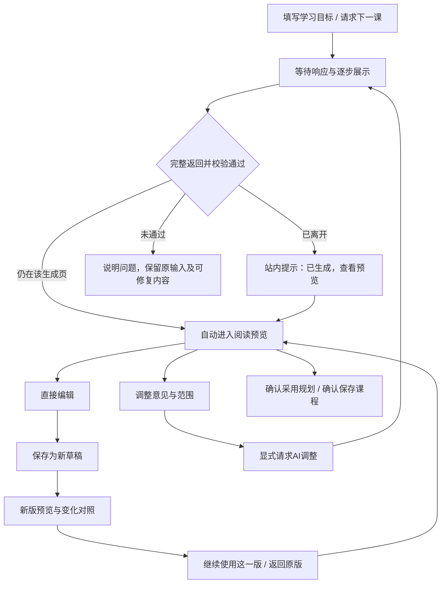

# 从生成到预览、调整与确认保存

日期：2026-10-14。状态：已实施，验证范围见verification.md。主场景为“学习 → 学习计划”，使用当前平台风格及本地存储体系。

## Context

用户希望知道生成是否正常，完成后直接看规划或课程，不先面对技术记录或大段编辑表单；发现不合适的地方，可以手改或让AI按意见调整。

现有能力以本次代码检查为准，不能用此前实施记录替代当前状态：

| 代码位置与事实 | 设计影响 |
|---|---|
| `copilot/transport.py` 已请求模型SSE，接收文本增量 | 无需另接模型服务或新增依赖 |
| `plans/generation.py` 把增量累积到持久化attempt.raw，结束后才校验及建立草稿 | 渐进展示与可采用草稿必须分开 |
| `plans.js/watch` 每1.5秒读取任务；规划JSON不完整时退回原文显示，完整后才显示阶段 | 补充可读片段解析，不默认暴露JSON；轮询本身不等于重新生成 |
| 完成后仍需“打开草稿”；规划先出现表单，课程先出现两个文本框 | 新增独立阅读预览，编辑变为按需进入 |
| `navigation` 只由计划内部shell更新，`goTab`可直接隐藏整个计划页 | 自动跳转必须感知全站栏目切换，不能只比较内部计数 |
| 手动修改创建新草稿，但没有完整父子关系和版本选择 | 增加草稿谱系及基线哈希，区别正式规划v1/v2 |
| 现有AI后续规划修订针对已采用规划；没有任意未采用草稿的意见/范围合同 | 必须补服务端能力，不能只有一个“重新生成”按钮 |

当前资料入口已支持标题与粘贴内容等形式，传输超时配置也有变动。本设计不回退这些已有修改；实施前再次核对。来源展示按实际准备和核验情况说明，不把书名、链接或默认资料自动标为已核验全文。

## Goals / Non-Goals

**Goals:** 等待过程可理解；完成后立即阅读；手动与AI调整连贯；只修改选定范围；每次调整可比较、可放弃；正式保存有明确边界。

**Non-Goals:** 不做打字动画伪装流式，不暴露模型内部推理，不预测准确完成时间，不自动采用或批量生成课程，不改已发布课程正文，不新增任务调度或通用聊天。旧“课程管理”和未实施的AI复盘不计入此次交付。

## Decisions

### 1. 主流程



“继续使用这一版”仅选择当前草稿，不是正式发布。默认主按钮始终是针对当前所见版本的明确确认，不因生成完成自动创建计划或写正式课程。

### 2. 生成页：真实状态与等待反馈

示意文案：

```text
正在生成你的学习规划…
已等待 18 秒 · 收到内容后将逐步显示

阶段目标与课程安排将在这里出现。

返回学习计划       停止生成
▸ 生成详情（模型、用量、费用、任务记录）
```

| 实际事件 | 中文提示与行为 |
|---|---|
| 请求已提交，尚未收到文字 | 正在等待AI响应；显示已等待时间和轻量动画 |
| 收到文字但尚无可安全解析条目 | 已收到内容，正在形成可展示的安排；不显示JSON碎片 |
| 有可展示内容 | 正在生成，可先查看已返回部分；内容注明“生成中预览” |
| 提供方明确完整结束，服务端开始验证 | 正在检查内容格式与课程安排 |
| 校验成功 | 草稿已生成，进入预览或站内提醒 |
| 请求状态暂时无法读取 | 连接暂时中断，正在重新读取状态；不直接断言模型失败 |
| 校验失败 | 已返回内容需要修正；列出可理解的具体问题 |
| 取消/服务端失败 | 已停止/生成未完成；保留原输入和上一版，说明可做什么 |

计时依据服务端started_at，刷新不归零；等待提交到启动可单独显示，不能伪造排队人数。无首字或长时间无增量时提示“暂未收到新的内容”，不编造“正在检索”“深度思考”等内部活动。没有可信依据不展示百分比或剩余秒数。“已形成3个课程条目”是展示计数，不是整体进度百分比。

等待较久时“可离开此页，服务运行期间生成会继续，稍后回来查看”；同时明确关闭本地服务会中断任务。模型、费用信息放在折叠详情；无用量或价格继续显示未知。

### 3. 渐进展示：复用模型流式与现有轮询

第一期继续使用已有1.5秒状态读取，呈现模型实时返回的片段；不增加浏览器WebSocket/SSE连接和新依赖。这里是“模型流式返回、页面定期增量更新”，不宣传逐token推送。后续如确有延迟需求，再复用相同进度合同增加SSE。

- 新增只读进度接口 `GET /api/plans/attempts/{id}/progress?after_revision=N`。返回服务器时间、state、phase、单调revision、首字/末次增量时间、可读preview、结果draft_id及允许操作。无变化可返回轻量状态。请求不启动或重试模型。
- 现有attempt读取接口保持兼容，原始输出留在折叠诊断入口，主页面使用精简投影，避免每次传完整上下文与全部原文。
- 规划：在服务端识别顶层stages、lessons数组中**完整闭合且结构有效**的对象，再用标准JSON解析；处理字符串转义、嵌套、跨分片和字段顺序，不补括号猜测、不eval。无法可靠提取时只显示等待提示；最终仍必须完整解析和校验。按阶段/课号稳定更新卡片，不重建整页。
- 课程：按现有正文/资料分隔协议拆开，正文逐步显示；未结束Markdown段落可以先安全纯文本显示，完整块再排版。资料摘要独立区域，不混进正文。所有输出经过既有安全渲染，不执行HTML/脚本。
- AI局部调整：只显示返回的目标课次/章节，合成完整新版必须等结果通过范围校验；未修改内容取自已保存基线。
- 页面不逐字符播放已完整返回的内容。上滑阅读后停止跟随，显示“回到最新内容”；只有原本处在底部才自动跟随。避免整块替换导致滚动、焦点与折叠状态丢失。
- 未完成片段不能编辑后绕过完整性标记直接发布。完整但结构有误的结果可进入“修正草稿”流程，修正后重新校验。

新增phase用于UI投影：waiting/receiving/validating/ready；attempt主状态继续兼容queued/generating/ready/failed/cancelled。不能用前端计时伪造validating。校验很快时允许直接显示结果，不人为延长动画。

### 4. 自动进入预览与刷新恢复

自动进入仅在同时满足以下条件时触发一次：当前栏目为plans，当前子页确为该attempt的生成页，页面可见、没有未保存编辑，并且对应完整草稿校验成功。通过全站`goTab`离开钩子、页面visibility状态与当前attempt身份共同判断；不能只依赖plans.js内部navigation变量。

用户离开、打开其他草稿、切到其他浏览器标签或页面后台时，不切换内容、不移动焦点。应用保留站内“生成完成”提示和学习计划入口计数，用户点击才进入相应预览；不申请系统通知权限。

任务观察器与页面渲染分离：前台生成页约1.5秒读取，其他页面/后台降低频率，返回前台立即读取。网络失败只重试只读查询且有退避；结束后停止监听，取消重复定时器。隐藏页面回到前台若任务已完成，显示查看预览入口而非突然跳转。

应用初始化查询活动及近期结果；刷新只恢复状态，不重新POST生成。允许URL fragment保存安全的attempt/draft编号，深链恢复须验证编号；不在地址存学习正文、意见或密钥。站内提示按attempt去重；历史生成记录仍可手动查找。

### 5. 默认阅读预览

**规划预览**：标题与目标、基础、周期/频率/每次时长、总课数与每周投入；阶段卡片与逐课目录。课次可展开目标、练习、自查和先修。已发布课次标记“已发布，保持不变”。显示实际预算情况，未知不冒充适合用户。

**课程预览**：课次、主题、日期和所属规划版本；排版后的正文、示范、练习、默认折叠的参考分析；资料摘要与来源/核验边界可展开。生成完成立即可读，不要求先保存一个手改副本。

共同操作区：

```text
规划预览 / 第001课预览          草稿第2版 · 查看版本

                 可读的规划或课程内容

直接编辑       告诉AI怎么调整       确认采用规划 / 确认保存课程
```

这是交互结构示意，不是已实现页面或视觉定稿。沿用现有样式变量，正文阅读宽度约720–840px；窄屏操作换行、内容自然滚动，键盘焦点可见，状态区域使用低频aria-live，不逐字播报模型内容。

确认按钮明确绑定所见draft_id和内容哈希。发布成功才显示正式保存路径，并进入计划详情或课程阅读；失败留在预览并保留当前版本。规划仍执行时间预算及明确接受超额的原合同。

### 6. 直接编辑

点击后进入编辑模式：规划使用结构化表单，课程使用正文与资料编辑区，同时允许切换阅读预览。提供“保存修改并预览”“放弃本次修改”。手改不调用AI。

- 所有输入均是本地未保存编辑，用户离开或发起AI调整前须选择保存或放弃；服务端校验失败保留输入并定位问题。
- 保存创建不可变子草稿，不原地覆盖父稿；没有变化时返回原稿或提示无修改，避免无意义版本堆积。
- 规划支持增删阶段、调整未发布课次顺序和条件。涉及课号重排时明确预览新旧映射，先修关系必须重新验证；已发布序号与内容不变。局部改目标不会自动改周期。
- 课程正文、资料、标题/日期、答案分隔等仍受当前发布合同约束；“编辑”不绕过来源或规划基线检查。

### 7. 告诉AI怎么调整

调整面板包含三项：**想怎么改、修改范围、作为依据的版本**。快捷意见只填入文本，不直接调用模型。

| 对象 | 可选范围 | 示例 |
|---|---|---|
| 尚未采用的规划 | 整份规划 / 选定课次与字段 | “第1–3课更基础，增加完整示范，保留20分钟安排” |
| 已采用规划的修订草稿 | 全部未发布部分 / 选定未发布课次 | “后面的练习换成工作情境，已发布课程保持不变” |
| 未发布课程 | 整课 / 选定章节 | “只把完整示范换成项目协作的例子” |

规划全局调整若要改变周数、频率或时长，须在面板的学习条件中明确修改；只写“缩短一点”默认缩短解释，不由AI擅自改计划总课数。部分课次调整不允许增删、重排课号或改变阶段结构；需要这些操作时选择全局调整或直接编辑。

课程章节由服务端基于基线内容生成稳定section_id、边界和哈希；用户选择标签，不输入任意偏移或路径。遇重复标题使用编号区分；无法安全分段时仅支持整课调整。标题、课号、日期与来源约束是受保护字段，不由局部意见绕过。

示例与练习、答案可能相互关联，界面提示可同时勾选“练习、参考分析”；不替用户悄悄扩大范围。如果范围不足以完成意见，报告需扩大范围，不自动重试。

发送前显示简短概要：基于哪版、目标范围、意见及实际发送的上下文、当前模型，调用可能产生费用。为保证连贯性，可以发送本草稿中未选部分作为只读上下文，但必须明示；不附带其他计划、私人笔记或未选择反馈。最终按钮为“生成调整后的草稿”。

### 8. 范围必须由服务端保证

单靠“请只修改这些内容”的提示不足以保证边界。本次采用受限结果与服务端合并：

- 规划局部调整输出目标课次允许字段的结构化更新；服务端验证课号在选择集合内、字段在白名单内，未选字段和对象直接取原稿。非法目标拒绝整次结果，不静默采用部分错误更新。
- 课程局部调整输出 `{section_id, content}` 列表；仅替换被选基线章节。其他正文与资料保持原样，再对合成全文重新校验。涉及资料摘要也须显式选择，并沿用来源快照。
- 全局调整可返回完整新文档，但所有已发布课次必须与当前正式版本对象一致。课程已发布后不接受本接口调整；改错另行设计。
- 最终校验包括完整结束信号、结构、数量、时长、先修、冻结课次、来源快照、完整正文与资料、分隔位置。结构通过不能证明教学内容正确，仍展示为待本人审阅草稿。

意见与资料视为数据，不执行其中要求读取文件、调用工具或覆盖路径的指令。AI输出不能控制保存目录或正式发布。

### 9. 草稿谱系、比较与正式版本

草稿编号与正式规划v1/v2分开显示。每次初次生成建立一个draft_family；手改/AI调整保存 `parent_draft_id、family_id、content_hash、operation、attempt_id、instruction、scope、created_at`。父稿内容不可修改。已有草稿缺少关联信息时标为“历史草稿”，在首次显式调整时建立可确认的新谱系，不猜测历史父子关系。

版本面板显示时间、来源（首次生成/手动编辑/AI调整）、调整意见与状态；允许从任意完整可用旧稿另起调整分支。“上一版”默认指当前稿的父稿，不等于最后按时间创建的稿。

差异由服务端/客户端基于真实内容计算，不相信模型自述：

- 规划：目标与时间条件、阶段变化、课次增删及移动、每课字段差异，冻结课次单独标注未变。
- 课程：逐章节变化及资料变化，可查看前后文本；未修改部分可折叠。
- 生成中当前选定旧稿保持可用；新稿失败不改变选择。新稿成功后进入对比预览，用户可返回原版或继续使用新版。发布按钮绑定当前明确选择的版本，不能默认悄悄采用最新时间戳。

建议新增 `learning_draft_families` 保存family的目标对象、已发布草稿及版本；其他元数据在现有草稿/attempt JSON中增量增加。初次规划同family多个草稿只能首次建立一个正式plan；其中一稿采用后，兄弟稿标为基线过期，不能通过换请求键再建一个计划。用户若要继续修改，须从当前正式版本开启新的修订family；“复制成独立计划”不在本期。

课程family绑定plan_id、lesson_no、base_version和source_hash；任一稿发布后同family其他稿不可再次发布。发布接口同时校验最新正式状态，UI禁用不是唯一保护。幂等键只表示同一操作，不能绕过已发布限制。

### 10. 冲突、跨日与失败处理

| 情况 | 处理 |
|---|---|
| 调整时父草稿哈希不匹配 | 拒绝请求，重新载入；不启动模型 |
| 生成期间用户手改产生新稿 | AI结果仍基于原父稿，可独立比较；不覆盖正在编辑的分支 |
| 正式规划已更新或来源清单变化 | 保留结果供看，禁止直接采用/发布；回当前基线重新发起或手动核对 |
| 生成期间课次已被发布 | 再次核验冻结范围或同日/同课发布状态，拒绝冲突版本 |
| 课程跨日后保存 | 提示日期变化；用户确认后创建更新日期的子草稿并重新预览，原稿不被原地改写，仍执行同日限制 |
| 服务重启、中断、取消 | 不恢复付费生成；保留原稿、输入及任务结果，未完整片段不可采用 |
| 完整返回但格式不合格 | 展示校验问题，支持可结构化恢复的手动修正；无法解析时保留诊断内容，重新生成须显式操作 |
| UI状态读取失败 | 只重试读取，恢复后由服务端状态决定是否进入预览 |

任务总时限须明确可配置并记录deadline；建议新任务默认300秒，可在实施时尊重用户已配置的更长值。当前传输读取超时不等价于任务总时限，实施时不擅自回退用户最新传输配置。超时和取消只表示本地停止接收，不能承诺提供方不计费。

### 11. 接口、存储和兼容

- 复用现有创建、读取、采用、发布及取消接口；新增只读进度接口、草稿family查询与差异接口。
- 建议 `POST /api/plans/drafts/{id}/refine` 接收request_key、parent_hash、instruction、scope及明确的新学习条件。创建前校验完整可编辑草稿、范围、冻结状态；返回attempt，沿用共享AI生成锁和既有任务持久化。
- 手改端点补父稿与内容哈希，返回新的关联草稿。服务端保证family关系、类型及目标一致，客户端不能把别的计划草稿嫁接过来。
- 正式版本、来源、外部文件哈希、预算与重复发布检查继续保留。生成和编辑只写本地草稿数据库；确认后才通过现有发布流程写规范目录。
- 备份包含新增family表、草稿元数据及请求状态；旧JSON state同步不能删除它们。迁移不修改用户课程文件。外部规划修改仍走现有冲突核对，不用AI调整覆盖人工变更。
- 草稿版本和任务列表要分页，不继续只依赖最近30条草稿/20条任务，否则旧分支可能无法找回；对当前family提供完整可分页访问。
- 生成配置、密钥不进入进度内容、差异结果或日志；模型输出按文本渲染。优先限定为本计划模块的增量修改，不顺带重构旧课程管理。

## Risks / Trade-offs

- 只做完成后跳转仍留下等待空白 → 同时补真实状态和渐进内容，但不引入新的实时连接基础设施。
- 部分JSON解析容易误提取 → 只接受语法完整对象，严格识别结构与转义；失败就显示状态，不猜测修补，不影响最终完整校验。
- 局部调整导致上下文不一致 → 显示关联章节提示，由用户选择范围，合成后重新检查；不能保证语义一定正确。
- 自动跳转打断用户 → 全站导航、可见性、当前任务身份共同限制，后台只提示。
- 多稿造成误发布或重复计划 → family级发布约束、明确版本选择、真实diff及最新基线校验。
- 既有源码仍在更新 → 实施前重核资料合同与超时设置，保留其他改动；本设计不宣布现有改动已通过验证。

## Migration Plan

1. M1：真实中文状态、可读增量和恢复，不改变正式发布合同。
2. M2：默认阅读预览、仅在合适时自动跳转、直接编辑与离开保护；可先独立交付。
3. M3：草稿family、按范围AI调整、差异和版本选择，完成全部用户流程。
4. M4：隔离回归与经授权的真实页面/模型联调；更新使用说明与备份范围。

回退时关闭新调整入口并保留草稿、family表和正式文件；旧只读草稿仍可读取。为避免回退绕过同family限制，发布服务端保护不能单独移除；必要时先禁用新谱系的发布。不要删除表或恢复整库来撤销页面。

## Open Questions

默认采用“原生页面、既有轮询、增量预览、显式采用”，无需额外选型即可实施。真正浏览器SSE推送、旧认知课程的同款改造、AI复盘复用、已发布正文更正另行推进。本次没有新增依赖、运行服务、调用模型或实施UI。

相关文档：[生成反馈规格](specs/generation-progress-feedback/spec.md) · [预览规格](specs/generated-content-preview/spec.md) · [调整规格](specs/scoped-draft-refinement/spec.md) · [实施清单](tasks.md)。
