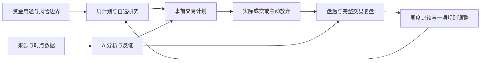

## Context

设计日期：2026-10-25。用户已确认「短线交易与波段复盘为主」「A 股与国内基金/ETF 优先」，同时需要理财投入计划、投资思考、AI 建议和股票分析。本设计按个人自用工作台规划；这是最初设计背景，当前已实现切片与待办以 tasks.md 和 2026-10-28 验收记录为准，不代表全部能力已交付。

2026-10-26 同步审查修订：产品流程与手算核对例见 [投资工作台设计](../../../docs/investment-review-module-design.md)，本文件补充工程决策，行为规格与唯一任务清单分别为本变更的 specs 和 tasks。变更边界时同步更新，不在产品文档另维护按周排期。

市场依据与访问边界见 [research.md](research.md)。调研采用官方文档，没有实测付费产品，也没有证明任何产品或本方案能提升投资收益。

当前 Grow 为 FastAPI + PostgreSQL + 原生 JavaScript/CSS，按账号隔离数据，五个主栏目为今日、行动、学习、记录、成长。现有 stocks 模块把每条操作保存为 JSON，含价格、整数数量、理由、目标/止损、信心、主观成功/失败与复盘；没有实际成交批次、完整现金流或策略版本。旧卖出记录按卖出价与之后价格比较所得的数值是事后比较，不能当成历史成本法下的已实现盈亏。

既有 AI 配置按账号留在浏览器，请求时提供服务地址、密钥和模型；后台任务能持久化状态，但目前的具体任务类型与课程耦合。阅读来源模块是有限订阅/文章读取能力，不是金融行情或全网研究服务。新投资能力须评估可复用部分，不直接宣称金融数据、任务或 AI 工具调用已经可用。

## Goals / Non-Goals

**Goals:**

- 在交易前说明资金边界、策略、触发条件、失效条件与风险；交易后还原事实并修正规则。
- 支持股票、场内 ETF 的做多短线/波段主路径；国内场外基金保留申购赎回和长期计划副路径。
- AI 能提出有证据的理财与交易方案、分析股票/ETF、比较情景、质疑原假设，并追踪其后续表现。
- 每条重要结论可回到来源、时点、计算和采用记录；用户可直接从报告转成计划或待研究项。
- 记录负担可控：先保存一句话/成交事实，深入分析按需展开，无每日交易、连续打卡或必须填满要求。

**Non-Goals:**

- 首期不接自动下单、券商交易密码、融资融券、期货期权及杠杆衍生品。
- 不承诺收益、胜率、止损必成交、最优仓位或模型必然预测市场；不以高交易频率为使用目标。
- 不在数据、许可和撮合约束未验证前交付全市场实时荐股、自动调参或分钟回放。
- 不改造 LightTick/Zook，不将私人投资资料写入 GitHub 正式课程仓库。

## Decisions

### 1. 产品主线：策略驱动的投资工作台

核心实体是「一次投资逻辑及其完整交易」，不是单张买卖记录。同一股票可在不同时期使用不同策略，不能仅按代码合并；同一逻辑内的分批进出归为一个 campaign。首版同一账户同一证券同时仅允许一条进行中的 campaign，支持其内分批进出；长期底仓与短线策略并存的独立损益分配须另补成本与账户对账规格后扩展。不同真实账户独立记账，不能靠复制持仓实现策略隔离。实际成交始终可如实保存，分配冲突保留待核对，不能丢弃成交事实。

选择这条主线，是因为仅增强记录表不能还原交易，默认进入聊天又不能保证计算和历史可追溯。聊天作为研究入口，结构化资料与实际成交才是后续复盘的依据。

### 2. 页面与真实使用流程

「记录 → 专题记录 → 投资工作台」承接旧入口，首版采用三个主要页面，不增加 Grow 主栏目：

| 视图 | 默认展示 | 主要动作 |
| --- | --- | --- |
| 今日与计划 | 当前交易日/休市状态、待处理持仓、已确认计划、月预算、周策略、数据截止时间 | 盘前准备、确认版本、暂停新增风险、盘后检查 |
| 交易簿 | 现金、实际成交、可卖数量、完整交易链与关联研究 | 手工录入、导入预览、分批归属、核对差异 |
| 复盘与策略 | 盘后/交易/周月复盘、AI建议跟踪、策略与思考 | 对照事前版本、确认标签、记录反例、形成规则试验 |

自选研究作为今日与计划内的列表，股票/ETF研究从列表或计划/成交详情展开；策略、原则、思考和周期统计使用页内视图。复用既有阅读、笔记与知识图谱的稳定引用，不另造投资知识库学习状态或独立HTML页面树。

桌面以列表和详情并排；手机默认卡片与单列详情。「记录一笔」「写个想法」常驻，费用、归属、反证等细节渐进展开。新用户先建一个交易账户和用途边界，再建少量自选/一套策略，允许只使用日志，不要求先完成财务问卷。

盘前流：看已知市场与隔夜事件 → 检查现有仓位 → 从观察名单挑出本人需要研究的少量标的 → AI/手工形成条件计划 → 本人确认。盘中流：按原计划在券商操作 → 本工作台记录成交/偏离；无新证据无需重跑 AI。盘后流：核对成交 → 对照计划 → 留一句复盘 → 必要时深入。

### 3. 时间维度：月预算、周策略、日执行、交易闭环

以下为产品默认建议，可调整和关闭。分钟数是交互设计预算，不是已验证的效率结论。

| 时间维度 | 内容 | 默认投入时间 | 输出 |
| --- | --- | --- | --- |
| 首次建立，季度/重大生活变化复核 | 资金用途、收入稳定性、近期用钱、负债、能承受的损失 | 首次 20–30 分钟 | 资金边界与风险政策 |
| 每自然月 | 本月可投入金额、是否入金/提款、账户边界、总风险额度 | 20–30 分钟 | 月资金预算及实际偏差 |
| 每交易周，前一休息日准备 | 市场情景、可用策略、持仓处理、关注事件、观察名单 | 30–45 分钟 | 一份周计划和少量待验证假设 |
| 每交易日盘前 | 核对新消息、可卖数量、原计划是否仍有效 | 5–10 分钟 | 今日条件清单，可选择不交易 |
| 每次决策/成交当时 | 入场理由、风险、实际成交、偏离及情绪 | 30–90 秒快速记 | 带时间的事实与事前版本 |
| 每交易日盘后 | 核对实际成交、规则偏离、持仓变化、明日注意事项 | 5–10 分钟 | 一句话总结，按需深入 |
| 每个完整交易结束，或持有时限到达 | 结果、过程、时机、退出与假设检验 | 5–15 分钟 | 完整交易复盘与一项可检验调整 |
| 每周末 | 分策略、行情条件、执行与费用比较 | 20–30 分钟 | 保留/观察/暂停某方法及下周一项试验 |
| 每月/季度 | 净结果、回撤、资金流、基准与时间成本；季度检查策略稳定性 | 30–60 分钟 | 资金与策略调整草案 |
| 每年 | 生活目标、收入支出、长期资产与交易资金比例重新确认 | 自定 | 下一年度资金用途和方法边界 |
| 事件触发 | 重要公告、停复牌、交易规则变动、逻辑失效、本人设定的风险阈值触达 | 按事件 | 检查任务及可编辑方案 |

短线持有期可用「1–5 个交易日」、波段可用「5–30 个交易日」作为可编辑模板，而非适合用户的推荐期限。每项计划分别保存：准备日期、有效截至、预计持有交易日、最晚复核日、提前失效条件。计划有效期到达不意味着必须卖出；跨周仓位延续同一 campaign，不能为了周报强制平仓或重置风险。

周/月复盘的日历范围用于汇总，绩效同时提供按开仓日、平仓日和持有期间的说明；不混加不同归属口径。交易日历来自经核验市场日历，时区 Asia/Shanghai，交易日与自然日分开处理。当前 2026-10-25 是周日，示例任务应指向下一实际交易日，不能简单在每个周一到周五都安排开市任务。

### 4. 资金投入计划与理财建议

用户偏好短线/波段不代表所有资产都应进入交易账户。资金计划先回答：这笔钱何时要用、亏损会不会影响生活、已有负债与现金流、是否有独立长期目标。风险意愿与实际承受能力分别记录；缺少信息时给教育说明和待补资料，不猜资产配置比例。

用途分为生活备用、已知近期支出、长期目标、交易资金，可不填写绝对金额而仅填用途/区间。建议候选包括：补足流动性、比较负债成本与不确定收益、限制单一行业暴露、评估基金费用/赎回约束、分开长期持有与短线试验。这些建议必须解释依据、替代方案、缺失信息、调整后影响；不默认某笔资金适合交易。

月度计划保存：期初交易净资产、拟新增/取出资金、现金缓冲、单笔风险预算、日/周累计亏损检查线、最大持仓暴露、同板块合计暴露、允许策略、是否暂停新增风险。具体比例由本人设置或在补齐资料后参考多个情景决定，不写死 1%/2% 等默认建议。亏损后不自动建议充值、加仓或提高风险追回损失。

「计划投入」「账户实际入金」「实际买入金额」「持仓市值」「初始计划风险」分别展示。暂停新增风险是计划状态，不是强制清仓；仍允许如实补录违规交易并标记偏离。

仓位计算由程序完成：在给定入场价、失效价、费用/滑点假设后，计算预算内可容纳的数量，再受可用现金、组合暴露、最小申报单位和账户权限约束。展示公式、假设和取整结果，缺关键输入时不生成数量。

计划风险仅是假设在指定价退出的损失估算。系统须额外展示隔夜跳空、T+1、跌停/停牌等可能使实际损失超过预算的情况；不能把风险预算显示成最大保证损失。

### 5. 三层计划与策略版本

**资金政策 → 周策略计划 → 单次交易计划**分别承担不同职责。AI 提出草稿，本人确认后生效。

策略模板仅提供结构，例如趋势回调、区间突破、事件观察、ETF 波段，均标为待验证假设。每套策略保存：适用环境、观察周期、必须满足的条件、排除条件、触发与失效、退出/减仓/时间规则、风险限制、验证方法、创建/停用版本。技术指标数量不等于证据强度。

单次交易计划最少包含标的、策略/理由和计划有效期；要生成可执行条件建议，还需入场条件/区间、失效条件、预算与持有期。进一步可补：替代标的、为什么现在、为什么不买、事件风险、预期检查点、风险估算、收益情景及计算依据。

状态：`draft → confirmed → watching → entered → managing → closed → reviewed`；可分支为 `declined / expired / cancelled`，已经发生的成交不能通过取消计划删除。确认版本保持不可变；首笔成交冻结所用策略、计划与风险快照。之后调整产生新版本，记录生效时间、理由、是否在成交后补记。真正事前记录与事后补记必须区分，补记不能用于证明当时遵守了计划。

无计划成交允许快速记，明确标为事后补录且 R 缺失，避免为了填表伪造事前止损。临时放宽失效价不会改写原风险分母。

### 6. 股票与 ETF 研究框架

AI 首先核对证券身份与市场，不以简称/六位数字作为唯一身份。每个标的存代码、交易所、品种、板块/状态、有效期、数据来源和对应规则版本。

| 研究模块 | 主要问题 | 证据与实现 |
| --- | --- | --- |
| 市场与板块 | 当前是何种趋势/波动环境？与所选策略有何关系？ | 指数、广度、板块样本与成交数据；指标程序计算，AI 解释假设 |
| 量价与流动性 | 价格结构、量能、波动、价差和成交能力如何？ | 明确复权口径/周期的 OHLCV、成交额等；仅日线时不推断盘口 |
| 事件与催化 | 公告说了什么？何时发布？是否已反映在价格中？ | 公告原文、财报、基金文件；事实/市场预期/AI 推断分开 |
| 公司与财务风险 | 盈利质量、现金流、负债、重大风险与交易逻辑是否冲突？ | 原始财报期别、合并口径、公告时点；短线模式默认风险摘要 |
| 估值与中期逻辑 | 波段假设需要怎样的增长、利润或估值前提？ | 行业适配方法，盈利为负不硬算 PE；输出区间与敏感性，不伪装唯一合理价 |
| ETF 专项 | 跟踪什么、持仓重叠、折溢价、流动性和规则如何？ | 指数/基金文件、NAV/iNAV 各自时点；不同步不标为可交易套利 |
| 可成交性 | 是否停牌/受限？可卖多少？价格限制与账户权限是什么？ | 时点规则、状态、持仓批次和已核对账户数据；未知则待核验 |
| 组合影响 | 新增后行业、主题、相关风险和资金占用怎样变化？ | 当前组合与拟投入数量；缺底层持仓时不声称已识别重叠 |

输出固定顺序：结论与数据截止 → 已核验事实 → 支持理由与反对理由 → 情景/关键条件 → 交易与组合约束 → 缺失资料 → 可选下一步。

建议动作可为：进一步研究、等待条件、条件满足后评估入场、核对减仓/退出方案、维持观察、不参与。允许生成明确的条件式买卖草案，但触发条件、价格数据、适用期限、风险与用户约束必须可核验；不能以模型口吻替用户确认执行。

基本面好不推导明天上涨，技术形态不推导长期价值。「主力意图」「消息确定性」等未经直接证实的说法只能作为待核解释，不写成事实。截图可辅助理解，但不能单独生成精确仓位、精确回测或实时判断。

### 7. 深度利用 AI：六类工作与可追溯输出

1. **理财规划助手**：基于已选资金资料比较用途、流动性与风险情景；产出可编辑资金政策。
2. **盘前/盘后研究助手**：汇总自选相关的新事实、已有持仓风险和计划条件变化，避免无关新闻堆积。
3. **个股/ETF 深度研究员**：检索允许的资料、提取事实、调用确定性指标/情景计算、提出支持与反证。
4. **计划检查员**：在本人确认前检查计划是否自相矛盾，预算/权限/交易机制是否满足，指出具体缺项。
5. **复盘教练**：对照事前版本与实际成交，提出行为偏离候选；追涨、恐惧等标签须本人确认，不从一笔交易诊断心理。
6. **策略研究助手**：识别待检验规律，生成事先定义的试验；不能自行提高风险、改动策略或自动扩大交易规模。

调用链：`问题与目标 → 用户选择的数据预览 → 取数与证据核验 → 程序计算 → AI 主分析 → 反证检查 → 输出校验 → 用户采用/修改/拒绝 → 后续验证`。

主分析与反证可用同一个模型分步完成，成本较低；产品必须说明它不是独立意见或统计置信保证。多模型是后续可选配置，不因多个模型赞同而提高所谓成功率。

每份报告绑定：市场时点、资料可获知时间、抓取时间、规则/策略/输入版本、模型和提示模板版本、计算版本、证据 ID/位置、用户选择的发送范围。重要数字只能引用经校验输入或计算输出；事实引用必须能定位原文。模型生成新数字需标明假设，不允许把模型自报信心显示成经验证胜率。

每条建议卡包含：适用账户/策略、建议及原因、支持与反对证据、触发和失效条件、有效截至、风险/费用/流动性假设、缺失项，以及采用/修改/拒绝/暂存。输入不足时仍可生成有明确范围的研究说明；不得生成依赖缺失数据的具体价格或仓位。

问「明天可以买什么」时，先确认使用的资金/策略边界与资料时点，从本人自选或可核验筛选结果研究，列条件与不参与理由；不默认生成每日必买名单。问「这只股票会不会涨」时，拆成明确期限与可判定事件，保留不同情景与反例，不编造上涨概率。

轻量模式复用已有事实与确定性检查；深度模式由本人启动，显示资料覆盖、进度和预计消耗说明，能取消。按账号、标的、资料时点、输入版本缓存，变化后标旧；相同请求幂等，失败不自动重付费。报告生成不会自动修改计划或成交。

### 8. 数据时效决定能力层级

| 层级 | 可用数据 | 可以交付 | 不足时的明确行为 |
| --- | --- | --- | --- |
| 手工资料模式 | 用户记录/导入与注明日期的资料 | 日志、资金检查、历史资料分析 | 显示来源与日期，不声称最新行情 |
| P1 盘后研究 | 授权日线、日历、公告、规则与产品资料 | 次日条件计划、波段分析、盘后复盘 | 当日未齐标为未完成，继续用前一时点并标旧 |
| P2 盘中辅助 | 满足策略时效的分钟/实时行情、状态与规则 | 条件检查、执行偏差、区间回放 | 断流/延迟超阈值立即降级，暂停当前时点条件结论 |

每条数据保存 `effective_at`（事实/规则作用时间）、`available_at`（何时已对外可获知）、`retrieved_at`（本系统抓取时间）、`period_end`（财报/NAV统计期）、`source_id`、校验哈希与许可标签。研究时以 decision_at 为截止，仅使用当时已知资料；新闻发布早于抓取不等于本系统当时已读取。

日线新鲜度按交易日历判断，不能在休市日每隔几小时错误报过期。分钟/实时数据阈值按供应商 SLA 与策略周期配置，在 P2 验收时给出具体值。现有 AI Base URL 不自动具有联网能力，金融取数由服务端独立适配。

首个候选数据商为 Tushare 的日线能力，仍需验证股票/ETF/基金、历史状态、公告、复权、日历、许可、配额与失败行为；不默认所有接口免费。实时能力另做供应商比选，未通过不得解锁 P2。公告优先交易所/巨潮/基金公司原文，门户为补充。

官方 `rt_min` 为需单独开通权限的A股实时分钟接口，不能从一般积分推定可用；历史分钟与ETF分钟分别核验。适配器保留源单位并转换到统一单位：所核验日线文档量额为手/千元，实时分钟为股/元，不直接拼接计算。提高历史日线轮询频率不会产生实时数据。

### 9. 账本、收益和策略评价

**事实账优先。** 实际成交至少保存账户、标的、方向、成交时间、价格、数量、费用/税、来源与外部编号。现金流水区分入金、出金、分红、利息、费用与交易结算。数量/金额用 Decimal/数据库 NUMERIC，支持基金小数份额，价格保留品种精度；实际成交与复权价格分开。合同初始候选为价格/数量/金额 NUMERIC(28,10)，实现时确认来源范围；超精度显式处理，API用十进制字符串、显示舍入不改核算值。未知费用保留缺失状态，不能默认零后宣称精确净收益。

首期做多股票/ETF 使用明确披露的移动加权平均成本法核算经济盈亏，买入费用计入成本、卖出费用扣净收入，部分卖出按当时均价分配；尾差留给剩余仓位，清仓归零。首版单一进行中campaign与账户余额核对，后续多策略并行不隐式改变该成本口径。现金/持仓/成交派生流水与审计记录事务提交，派生流水带来源避免费用双计。该方法不是税务申报承诺，核对实际券商口径可显示差异。卖出现金到账不等于可取资金，若没有可用/可取的核验信息则不推断。

实现核对 [产品文档第四节手算例](../../../docs/investment-review-module-design.md)：期初10000元，两次各100股、价格10/12、各费用1元；以13卖50股、费用1元后，现金8447、剩余成本1651.50、已实现98.50；余150股以12估值时浮动148.50，总净变化247元。另验ETF三位小数与日线/分钟量额转换。分红、拆合份额等事件须有证据与重算规则，资料不足标待核对，不静默沿用旧数量。

计划/模拟与实盘独立；委托、条件触发、实际成交分别记录。CSV 先预览、校验、去重、标注时区和来源再提交；撤单不是成交，部分成交按实际分笔。冲销/更正追加审计记录并重算，不偷偷改写历史。

场外基金使用申购申请、确认日期、确认净值/份额、赎回申请/确认、费用和到账日期等独立流程。NAV 的公布延迟、赎回规则和持有期费用影响计算；不能套用股票盘中成交模型。

**复盘指标：**

| 问题 | 指标 | 数据条件与解释 |
| --- | --- | --- |
| 实际赚亏多少 | 已实现/浮动盈亏、分红、已知费用税 | 账户成本与流水齐备；估值日期显式展示，缺费用标未完整 |
| 承担多少风险换来结果 | 计划 R、实际净 R | 初始风险基数在事前冻结；无有效基数不算，实际亏损可超过 -1R |
| 方法有无值得继续检验的表现 | 净期望、盈亏比、Profit Factor、持有时长 | 按完整已结束 campaign，盈亏平三类；展示样本数与开放仓位，分母为零显示未定义 |
| 是否按方法执行 | 计划覆盖率、已核验规则遵守、偏离案例 | 无事前计划不算遵守，未知项不硬判失败；本人确认标签 |
| 退出/持有能否改进 | MAE/MFE、持有期、退出后观察 | 仅持有区间可核验高低点；变动数量按批次计算，无完整序列标缺失/近似 |
| 组合承受怎样波动 | 现金流调整后的净值回撤、最长回撤期、暴露 | 有足够估值序列才能计算，原始账户余额不能直接当净值 |
| 资金自身体验与策略比较 | XIRR/MWR、TWR及匹配基准 | 现金流/估值不足不硬算；XIRR无解/多解说明，短期不突出年化 |

简单已平仓单批做多例：初始数量 Q、成交入场价 P、事前失效价 S，初始价格风险为 `(P-S)×Q`，加上确认时说明的费用/滑点预算得到 R 基数；净结果除该冻结基数得实际 R。基数非正数则不算。分批加仓必须先记录新增风险：campaign 分母为各次事前增量风险预算合计，减仓/移动止损不减少已冻结分母；同时展示每批 R，禁止后补重置分母改善结果。

按策略、市场环境、持有期、是否遵守计划等条件比较时，显示筛选、时间范围和样本数。少于 30 个完整交易时默认提示探索性样本；达到 30 也不代表统计证明，需考虑行情阶段、交易相关性、参数筛选和成本。开放仓位仍展示浮动风险，不只看已平仓赢家。

### 10. 复盘、思考与 AI 建议的验证

盘后轻量三问：今天与计划最重要的差异是什么？发生了什么新事实？明天需要核对什么？没有交易可以保存「按条件未触发，未操作」，不计为零收益赢家或遗漏成交。

完整交易复盘并列展示原计划、过程、实际结果；分别回答逻辑是否得到验证、执行是否符合规则、成本和可成交性影响、哪些仍不确定、下一次只改变哪一项。盈利且违规、亏损且合规都能正常表达。

周复盘聚合案例，最多选择一项规则试验；月度复盘看资金净结果、回撤、交易频率/费用与时间投入；季度比较不同环境的稳定性。新规则保存支持案例与反例，状态为待验证/试用/保留/暂停，不能因为最近一笔亏损直接改写全部计划。

思考笔记支持「问题—当前看法—依据—反例—适用范围—下次验证」，一分钟可保存原文，AI 整理作为独立采用版本。文章、财报、交易、决策、错误与知识节点以 stable ID 引用，不复制第二份事实；删除/不可访问引用时显示失效，不泄露其他账号数据。

AI 建议账分成：

- **预测质量**：仅对事前定义的期限、判定条件和结果统计校准。概率由用户或清楚标注的模型估计记录，未校准模型概率不作为可靠胜率。
- **计划质量**：事实/引用正确性、完整性、可执行性、约束冲突与过期情况。
- **实际执行**：采用、修改、未采用、未触发、无法成交以及具体原因。
- **资金结果与代价**：净结果、风险、最大不利变化、费用及耗时；无法与市场/用户操作分离时明确不能归因于 AI。

未采用建议也保留，并可按预先确定规则做影子跟踪，但必须标为模拟、不证明可成交、不混入实盘。市场未开、条件未触发、数据不足、到期未判定不能当成失败。保留全部输出和撤回记录，避免仅挑选成功案例。

### 11. 回测和盘中辅助的验收边界

P0/P1 可开展人工纸面前向验证；系统化回测和行情回放属于 P2，不凭单份日线生成精确盘中体验。

P2 回测必须使用当时已可获得的数据，保存历史成分/退市样本与复权时点，避免未来财报、未来成分和复权因子泄漏；按交易日与买入批次检查可卖数量，纳入停牌、涨跌停排队、跳空、费用、滑点和成交量约束。

同根 K 线内先触止损还是目标未知时，采用预先声明的保守方法或标为无法判定；不得默认对策略最有利顺序。无法证明限价成交时不填成交。参数版本先冻结，再进行样本外/滚动/前向验证；保留失败试验，评价参数敏感性而非挑最好曲线。

盘中提示只说明核验到的条件，附行情时间、延迟、适用计划及规则检查。日线模式不能提供「刚刚突破」「现在可卖」等当前事实。提醒是检查线索，不是券商委托或成交保证。

### 12. 领域模型、合同与现有架构连接

新目录拟为 `知行成长/server/investments/`，按领域分 planning / ledger / research / analysis / reviews / providers；复杂度增长时再拆文件，避免先建立大型框架。前端逐步从 stocks 入口接入独立 investment 文件。

| 逻辑对象 | 职责 |
| --- | --- |
| accounts / cash_events / fills / corrections | 资金与实际成交事实，唯一外部编号及核对状态 |
| instruments / rule_versions / market_snapshots | 证券身份、可交易规则与行情/资料快照 |
| capital_policies / period_plans | 资金政策、月预算、周/日计划版本 |
| strategies / strategy_versions / trade_plans | 方法、事前计划、确认与变更记录 |
| campaigns / fill_allocations | 一次逻辑的交易链与成交分配，不取代账户总账 |
| evidence / research_notes | 来源、原文位置、提取值、时点和自己的思考 |
| analysis_jobs / analysis_reports / recommendations | 幂等分析任务、结果、建议、采用与有效期 |
| reviews / rule_experiments / evaluations | 交易/周期复盘、规则试验、AI评估 |

字段合同使用项目现有 snake_case，统一 opaque stable ID、账号范围、created_at/updated_at、version；金额/数量用十进制文本 API 表示，避免 JavaScript 二进制浮点误差。列表过滤/分页可预期，写入校验在边界，冲突返回 409，可选字段缺省不清空旧值。

初始合同族拟为 `/api/investments/{accounts,cash-events,fills,policies,period-plans,strategies,trade-plans,campaigns,research,reports,reviews}`；写入用同源保护，幂等键与版本检查。确认计划与采用报告是显式动作合同，在任务 1 形成准确 OpenAPI/模型后再实现，不将此路径草案视为已存在接口。

交易规则错误不阻止如实记录已经发生的成交，而是显示核对差异；规则校验阻止的是把不可验证/不可行方案确认成可执行计划。数据从券商导入时始终标来源，不能仅因与自建规则不符就删除事实。

复用 PostgreSQL 租户隔离、现有身份、AI 设置界面、任务中心交互和行动引用。后台调度需要独立支持投资任务，不直接复用课程 kind。既有任务默认单进程，延续当前部署约束；重启标 interrupted，不自动重试付费调用。AI 密钥只在本次工作进程内存保留，不写任务/日志；凭证仅浏览器持有的阶段不承诺无人值守定时 AI。定时确定性检查与定时 AI 分别建模。

来源访问校验 URL/重定向/私网目标/响应体，拒绝正文中的指令，外部资料只作数据。报告安全渲染，不执行模型 HTML/脚本；模型无下单/转账工具。金融数据商凭证沿用受管服务端秘密或经过独立设计的加密配置，不默认复用个人模型密钥。

报告发送前展示模型目的地和数据范围，可隐藏绝对金额；检查可用性时若只发比例无法计算数量，应明确限制而不是模型反推。资产、截图、策略和结果按账号保存在 PostgreSQL及受控私有附件存储，附件方案未实现前只支持文字/受限导入。搜索/导出/附件下载与缓存都执行相同账号授权，不自动把资金详情加入通用成长 AI 报告。

## Risks / Trade-offs

- 盘中时效与数据许可成本较高 → P1 先做盘后，P2 供应商能力、价格与授权单独验收；技术访问能力不替代分发许可。
- AI 可能用流畅叙事掩盖缺失 → 数值计算独立、事实引用定位、反证与缺项在建议之前可见，过期立即降级。
- 反复分析诱发过度交易 → 无变化复用结果、默认不操作选项、展示频率/费用/耗时，提醒由本人选择，无每日必买任务。
- 只看历史赢家或小样本 → 保留所有计划、未触发/未采用与开放仓位，展示样本/环境/成本，先影子或小规模验证；具体实盘规模由本人决定。
- 止损不能限制实际最大损失 → 明示 T+1、跳空、停牌/限价/流动性，压力情景与常规风险分开。
- 主观情绪归因可能误导 → 标签候选附行为事实，用户确认，不自动诊断。
- 国内交易与基金规则持续变化 → 规则带生效与实施状态、品种覆盖；未知阻止可执行性结论，不用过时常量补缺。
- 功能面过大 → P0/P1 各自交付完整闭环；高级回测、实时、原生端与全市场筛选留 P2，不阻止基本记录使用。
- 个性化建议对外服务可能涉及监管要求 → 本期按个人自用设计；公开/收费/代执行前独立进行法律与授权核验，不将本文当法律结论。

## Migration Plan

完整首版范围为 P0 + P1，包含用户要求的 AI 理财情景、股票/ETF 分析、条件计划与复盘。P0 是先验证事实与计划的内部里程碑，不代表用户全部目标已交付。P2 是以更高行情时效为前提的后续扩展。

1. **P0 基础闭环**：保留旧 stocks，新增私有领域表与备份覆盖；先完成资金政策、版本化计划、手工成交/导入、持仓核对与基本复盘。无行情/AI仍能使用。
2. 旧记录提供只读来源与人工关联，保留原值；缺实际成本、分笔与费用时标历史估算/信息不足。只在人工核对后形成新账本事实，并保存来源关系；幂等重跑不重复导入，不覆盖原记录。
3. **P1 盘后 AI**：验证首家数据商能力/许可，接入时点证据、研究模板、程序计算、AI报告、采用与跟踪；支持刷新后恢复任务，无模型配置不影响记账与复盘。
4. 与 Grow 今日、行动、时间线、搜索和周期复盘通过引用连接；默认只展示计数/待办摘要，金额与资金资料由本人选择显示或发送。
5. 用本人自愿选择的影子记录开展至少一个完整月的流程验证，统计数据缺失、记录耗时、计划覆盖、规则偏离、建议可核验率与失败恢复。一个月仅验证流程，不证明收益能力。
6. **P2 条件开放**：按已冻结的规则完成历史与盘中时效/交易约束测试，再逐项开放分钟回放、回测、盘中提醒；任何关键能力缺失保持关闭。
7. 回退优先关闭新建/生成入口，保留新数据只读与私有导出；不能删表或恢复旧整库覆盖期间新增交易。完整备份恢复必须覆盖新表、附件清单和来源哈希，密钥另行管理。

## Open Questions

已确定：A 股/国内基金ETF优先、短线与波段为主、人工执行、分阶段交付。以下未知不影响方案评审和 P0 合同设计，不用反复向用户询问批准：

- 实施 P1 前确定数据预算、候选供应商权限与个人/多用户许可；P2 另确认行情时效、分钟历史、真实交易规则覆盖及 SLA。
- 券商 CSV 的实际格式、费用口径、账户可用/可卖数据是否可获取，需在导入切片用脱敏样本确定；没有样本先交付通用模板与手工录入。
- 具体资金量、已有持仓、关注策略、可接受风险与时间投入，在真实初次使用时填写，用于生成个人方案；本文不猜这些参数。
- 用户是否需要未来无浏览器定时 AI 分析：当前凭证模式不支持，若需要，独立设计加密凭证与授权撤销，不在本轮暗中落库密钥。
- 同账户同证券多策略并存需新增成本分配、核对与审计规格，首版保持一条进行中交易链，不将缺少规则的独立策略盈亏作为已交付能力。

## 2026-10-28：公开参考规则与完整页面验证

首版规则服务采用随代码发布的有界公开参考（rules.py）：公开源、有效/实施状态、维护复核期限、市场/品种和哈希明确。程序自动对照已覆盖字段，历史/品种/动态状态未知不补造；不声称运行时追踪全量交易所更新。维护到期关闭自动依据，不简单续期。确认计划冻结比较与哈希，事实录入不因规则冲突被丢弃。

CSV和供应商共用十进制单位转换；完整日线在15:30后才允许接收当日记录，仍不承诺供应商已入库。Tushare新增显式公开日历模式，范围覆盖内只请求daily/fund_daily；供应商日历模式才请求trade_cal，不自动切换或伪称权限已验证。

新增生产index.html与真实登录/租户/HTTP的1440px和390px完整链、刷新与断网恢复；模型仍使用模拟边界。真实数据权限、真实模型效果和一个月流程质量验证保留在1.2/3.12；P2能力未因参考服务可用而开放。具体范围、官方来源与配置要求见根目录两份本轮文档。
