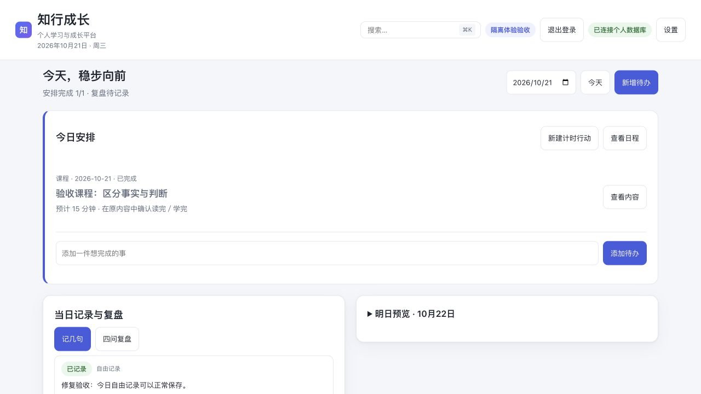
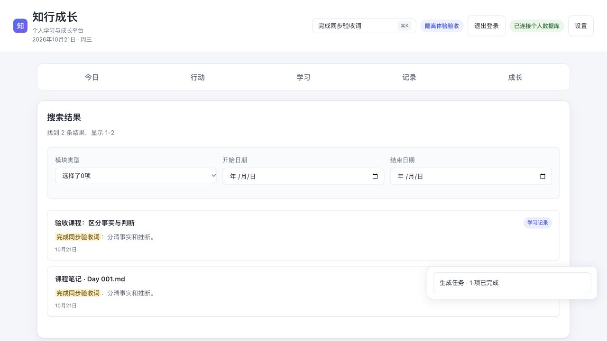
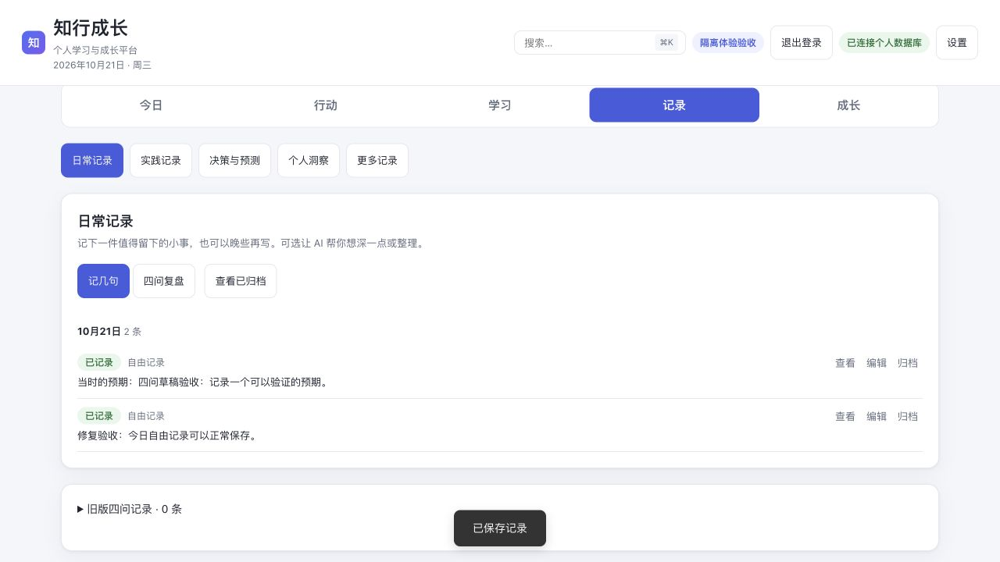
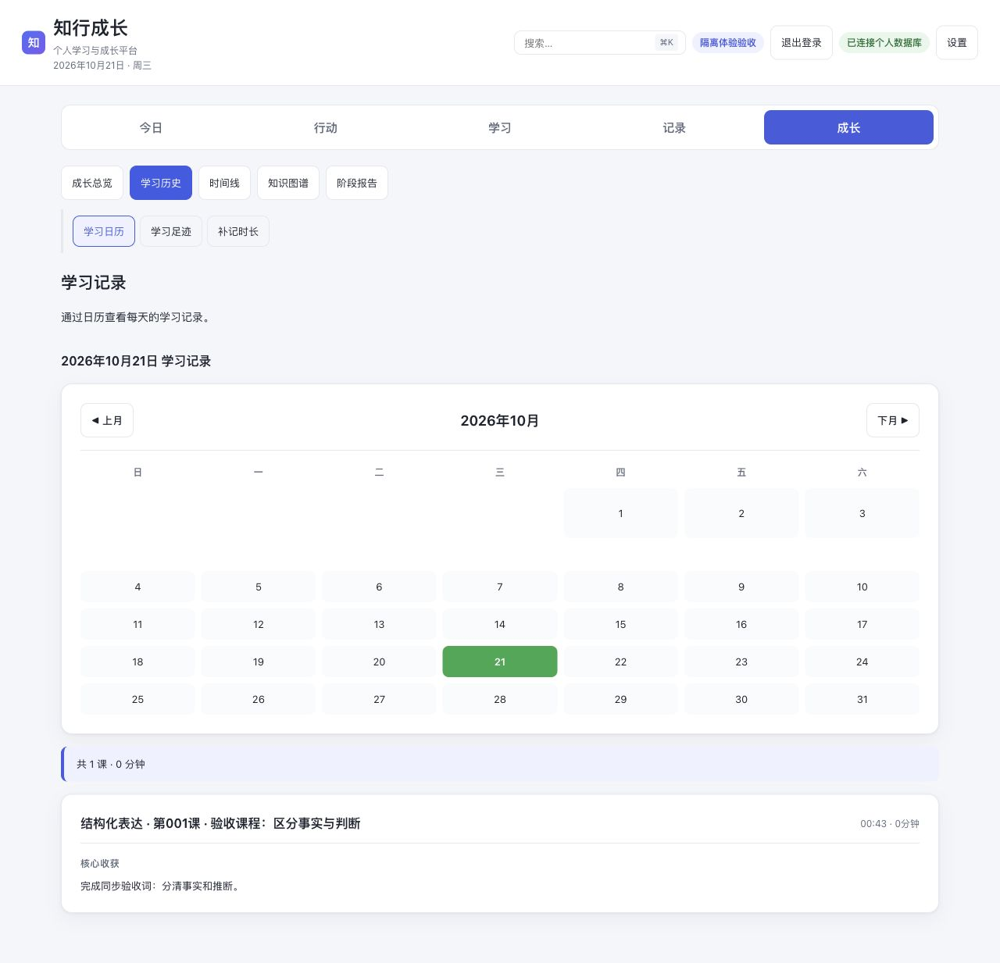
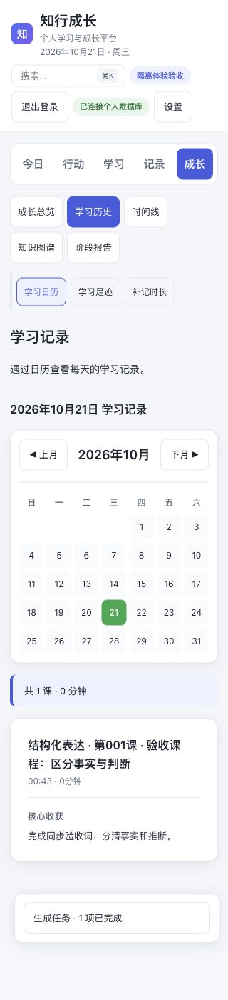
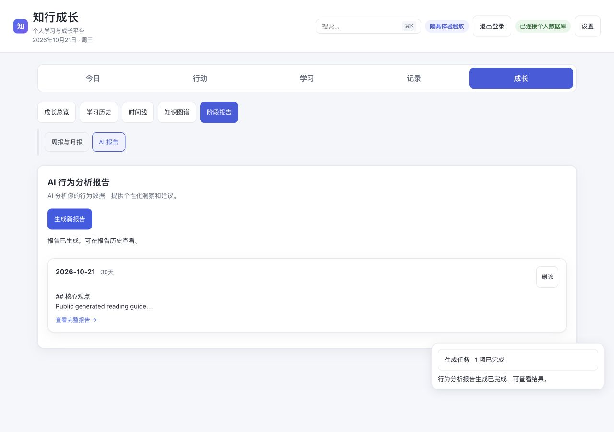

# P1 修复及二级导航验收

日期：2026-10-21（北京时间）。范围：知行成长当前本地工作区。保留工作区中已有的其他改动；本轮没有提交、推送或部署。

## 五个 P1 的处理结果

| 问题 | 已完成的修复 | 回归依据 |
|---|---|---|
| P1-01 记几句入口报错 | 修正日期与记录 ID 参数；未知 ID 有恢复提示。按账号保留本机草稿，冲突保持原版本；保存期间锁定编辑，失败恢复输入。自由记录和四问使用同一新记录模型，旧四问仍可查看、编辑。 | 今日、历史日期、记录页新增与已有记录编辑；仅填四问也可保存；草稿重开、账号隔离、过期版本、日期调整、保存中重复提交与失败恢复测试。 |
| P1-02 全局搜索、时间线失真 | 对接实际课程完成、课程笔记、学习反馈、文章／阅读笔记、日常记录及行动记录；来源故障独立回滚并提示部分失败，结果能打开正确目标。 | 真实 PostgreSQL 测试覆盖模块总集一致性、日期、故障隔离、归档、租户隔离和笔记来源；浏览器检索刚保存的笔记得 2 条，打开原课程后可返回原搜索。 |
| P1-03 完成后今日／行动不同步 | 课程、认知课程、计划反馈、文章读完统一等待行动快照与足迹刷新；保存成功但同步失败时单独提示可重试。核对完成先读取最新状态，已完成无需再次提交。 | 实际课程保存处理器、双击、丢响应同请求重试、同步失败与恢复测试；浏览器从今日开始课程，保存后立即显示安排 1/1 且进行中条消失。 |
| P1-04 足迹与报告口径不一致 | 总览、周月报、AI 摘要共用上海日期活动事实，合并自动完成和旧打卡；新日常记录进入报告计数。手工补记、课程学习和行动确认时长独立展示。 | 暂存不算完成、重复完成不增量、撤回、跨日、未来记录、连续天数、周月报、时长不重复累计及新旧复盘计数。 |
| P1-05 AI 失败存成成功报告 | 接入账号模型配置和现有流式生成器；模型失败、空响应、未完成响应、超时、断开或取消均不保存成功报告。前端显示设置入口、取消、保留范围重试与任务状态。 | 后端成功／失败／断开集成测试与前端 VM 测试；浏览器验证未配置提示，以及合成模型成功后在历史中查看报告。 |

## 二级导航与交互

| 主栏目 | 二级栏目 | 页内视图 |
|---|---|---|
| 今日 | 当日安排与记录 | 明日预览、可选继续学习折叠 |
| 行动 | 日程安排、目标与计划、执行记录 | 计划页仅预览最近 3 条执行，完整记录进入执行记录 |
| 学习 | 我的课程、阅读、课程规划 | 认知课程管理收在对应模块内 |
| 记录 | 日常记录、实践记录、决策与预测、个人洞察、更多记录 | 实践／错误、决策／预测、自定义／投资分别成组 |
| 成长 | 成长总览、学习历史、时间线、知识图谱、阶段报告 | 日历／足迹／补记时长；周月报／AI 报告 |

全局搜索保留顶栏入口。旧目标仍能访问；刷新恢复到具体页内视图，浏览器首次后退可回到今日。课程返回按钮按来源显示“返回今日安排／行动安排／搜索结果／我的课程”。日历日期使用原生按钮，支持键盘激活、可见焦点和选中语义；移除局部深色样式混用。修正空日期格受通用空状态样式影响而撑高行、挤压列的情况，320px 下七列等宽，日期按钮高度 36px。

搜索与时间线额外补齐查询规模边界：SQL 先按日期、关键词与阅读笔记路径筛选，精确计数、限制分页候选，并仅传输有界摘要；统计在数据库按日聚合。真实 PostgreSQL 回归验证 205 条匹配、每页 5 条时只归一化 5 个候选、总数仍为 205；统计不加载记录正文；跨来源分页、UTC 转上海日期和大正文截取均通过。

## 实际浏览器验收步骤

1. 今日新增自由记录并保存，重开已有记录；四问仅填一项，稍后继续后可恢复并保存。
2. 我的课程安排到今日，从今日开始，填写笔记并标记完成；立即返回今日显示安排 1/1，执行条停止。
3. 顶栏搜索刚保存笔记，得到完成记录与课程笔记；从笔记结果打开准确课程，“返回搜索结果”保留检索条件。
4. 成长阶段报告读取同一课的活动天数与连续天数；时长分来源展示。新日常记录计数另由后端真实接口测试验证。
5. 记录栏目显示 5 个分组，新记录和旧四问分区可达；学习历史进入日历，以 Enter 切换选中日期。
6. 在 320、768、1024、1440px 下检查 5 个主栏目，20 组检查均无页面横向溢出；另测 320px 日历七列等宽。
7. 未配置 AI 时出现前往设置提示；使用合成模型完成生成，报告进入历史、任务中心显示完成。模型失败及取消不落库由集成测试验证。
8. 首页空 hash → 成长 → 浏览器后退，界面恢复今日；刷新嵌套视图仍保持当前页。

## 验证范围与日志

- 后端选择了与本轮相关的 13 个测试模块，最终整组执行 105 项：104 通过、1 项浏览器 opt-in 跳过；失败 0、错误 0。
- 16 个不依赖 Playwright 的前端 VM／客户端脚本通过，覆盖真实入口处理器、状态同步、离开保护、导航、任务恢复与草稿。
- 浏览器验收使用 Codex 内嵌浏览器，未执行两份依赖单独 Playwright 的 `.cjs` 套件，也未声称完成仓库全量回归。控制台本轮采集无 warning/error。
- 所有真实业务集成测试使用专用本地 PostgreSQL 和临时租户 schema；隔离检查未触及真实数据库、未写个人学习资料、未请求外网。GitHub／模型使用合成 HTTP 夹具；没有验证线上部署或真实模型供应商的可用性。

复跑主要后端用例（将 DSN 改为可丢弃的 localhost PostgreSQL）：

```bash
cd 知行成长/server
TEST_POSTGRES_DSN='host=127.0.0.1 port=你的端口 user=你的用户 dbname=postgres' \
../.venv/bin/python -B tests/run_isolated_checks.py --pattern test_search_timeline.py
# 同样分别指定 test_growth_statistics.py、test_behavior_report.py，或其他相关模块。
node tests/test_reflection_entrypoints.cjs
node tests/test_learning_completion_sync.cjs
node tests/test_completion_producers.cjs
node tests/test_navigation_layout.cjs
```

日志：[后端回归](backend-tests.log)、[前端回归](frontend-tests.log)、[响应式矩阵](responsive.json)、[控制台](console.json)。

## 截图证据

以下均来自本轮隔离验收环境。步骤 2 截图是 P1 修复阶段、导航调整前捕获；其余分组截图体现最终导航。AI 示例正文由合成模型生成。

### 完成后即时同步



### 搜索找回刚保存笔记



### 记录分组与统一四问



### 学习历史与移动日历





### AI 成功状态与报告历史



## 后续体验建议

本轮已修复确认的阻塞与状态一致性问题。下一轮可继续验证新用户首次创建行动时的分类负担，评估“待办／计时行动／内容安排”统一创建入口；为长期使用、大量记录和弱网环境做更长周期体验；补充屏幕阅读器和真实手机触控验收。以上不作为本轮已完成项。
